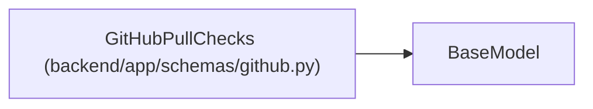

# GitHubPullChecks

**Location:** `backend/app/schemas/github.py:105`
**Kind:** Pydantic model
**Bases:** `BaseModel`
**Module:** [schemas_github](../modules/schemas_github.md)

## Description

Checks GitHub reported for the observed head commit.

## Attributes

| Name | Type | Wire name | Required | Nullable | Default | Constraints | Examples | Description |
|------|------|-----------|----------|----------|---------|-------------|-------------|----------|
| `state` | `Optional[str]` | `state` | No | Yes | `None` | — | — | — |
| `total` | `Optional[int]` | `total` | No | Yes | `None` | — | — | — |
| `sha` | `Optional[str]` | `sha` | No | Yes | `None` | — | — | — |
| `error` | `Optional[str]` | `error` | No | Yes | `None` | — | — | — |

## Methods

*No declared methods.*

## Relationships

<!-- Auto-generated relationship summary. Do not edit by hand. -->

### Summary

| Module | Methods | Attributes |
|---|---:|---|
| [schemas_github](../modules/schemas_github.md) | 0 | `error`, `sha`, `state`, `total` |

### Structure

| Kind | Entity | Module |
|---|---|---|
| Base | `BaseModel` | — |
