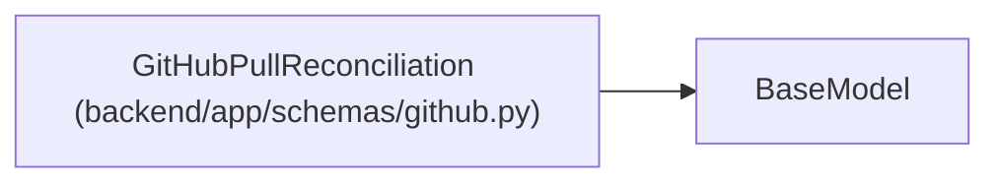

# GitHubPullReconciliation

**Location:** `backend/app/schemas/github.py:121`
**Kind:** Pydantic model
**Bases:** `BaseModel`
**Module:** [schemas_github](../modules/schemas_github.md)

## Description

A linked pull request compared with what the task submitted.

## Attributes

| Name | Type | Wire name | Required | Nullable | Default | Constraints | Examples | Description |
|------|------|-----------|----------|----------|---------|-------------|-------------|----------|
| `link_id` | `int` | `link_id` | Yes | No | — | — | — | — |
| `url` | `Optional[str]` | `url` | No | Yes | `None` | — | — | — |
| `title` | `Optional[str]` | `title` | No | Yes | `None` | — | — | — |
| `state` | `str` | `state` | Yes | No | — | — | — | — |
| `submitted_sha` | `Optional[str]` | `submitted_sha` | No | Yes | `None` | — | — | — |
| `submissions` | `list[GitHubPullSubmission]` | `submissions` | No | No | factory: `list` | — | — | — |
| `observed_head_sha` | `Optional[str]` | `observed_head_sha` | No | Yes | `None` | — | — | — |
| `target_branch` | `Optional[str]` | `target_branch` | No | Yes | `None` | — | — | — |
| `checks` | `GitHubPullChecks` | `checks` | Yes | No | — | — | — | — |
| `merged` | `bool` | `merged` | Yes | No | — | — | — | — |
| `merge_commit_sha` | `Optional[str]` | `merge_commit_sha` | No | Yes | `None` | — | — | — |
| `merged_at` | `Optional[str]` | `merged_at` | No | Yes | `None` | — | — | — |
| `closed_at` | `Optional[str]` | `closed_at` | No | Yes | `None` | — | — | — |
| `observed_at` | `Optional[datetime]` | `observed_at` | No | Yes | `None` | — | — | — |
| `observation_source` | `Optional[str]` | `observation_source` | No | Yes | `None` | — | — | — |
| `observation_error` | `Optional[str]` | `observation_error` | No | Yes | `None` | — | — | — |
| `review` | `GitHubPullReview` | `review` | Yes | No | — | — | — | — |
| `differences` | `list[str]` | `differences` | No | No | factory: `list` | — | — | — |
| `next_owner` | `str` | `next_owner` | Yes | No | — | — | — | — |
| `next_action` | `str` | `next_action` | Yes | No | — | — | — | — |

## Methods

*No declared methods.*

## Relationships

<!-- Auto-generated relationship summary. Do not edit by hand. -->

### Summary

| Module | Methods | Attributes |
|---|---:|---|
| [schemas_github](../modules/schemas_github.md) | 0 | `checks`, `closed_at`, `differences`, `link_id`, `merge_commit_sha`, `merged`, `merged_at`, `next_action`, `next_owner`, `observation_error`, `observation_source`, `observed_at` |

### Structure

| Kind | Entity | Module |
|---|---|---|
| Base | `BaseModel` | — |
