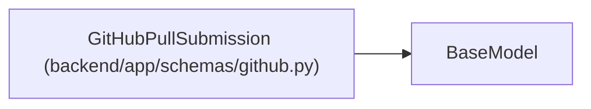

# GitHubPullSubmission

**Location:** `backend/app/schemas/github.py:94`
**Kind:** Pydantic model
**Bases:** `BaseModel`
**Module:** [schemas_github](../modules/schemas_github.md)

## Description

One run's submitted commit for a pull request, with the review that saw it.

## Attributes

| Name | Type | Wire name | Required | Nullable | Default | Constraints | Examples | Description |
|------|------|-----------|----------|----------|---------|-------------|-------------|----------|
| `run_id` | `int` | `run_id` | Yes | No | — | — | — | — |
| `commit_sha` | `str` | `commit_sha` | Yes | No | — | — | — | — |
| `commit_url` | `Optional[str]` | `commit_url` | No | Yes | `None` | — | — | — |
| `pr_url` | `Optional[str]` | `pr_url` | No | Yes | `None` | — | — | — |
| `submitted_at` | `Optional[datetime]` | `submitted_at` | No | Yes | `None` | — | — | — |
| `reviews` | `list[GitHubSubmissionReview]` | `reviews` | No | No | factory: `list` | — | — | — |

## Methods

*No declared methods.*

## Relationships

<!-- Auto-generated relationship summary. Do not edit by hand. -->

### Summary

| Module | Methods | Attributes |
|---|---:|---|
| [schemas_github](../modules/schemas_github.md) | 0 | `commit_sha`, `commit_url`, `pr_url`, `reviews`, `run_id`, `submitted_at` |

### Structure

| Kind | Entity | Module |
|---|---|---|
| Base | `BaseModel` | — |
