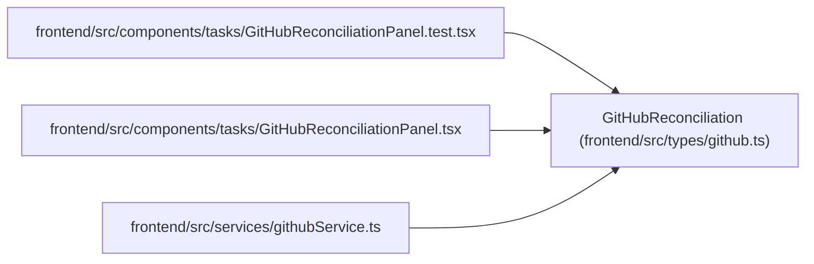

# GitHubReconciliation

**Location:** `frontend/src/types/github.ts:83`
**Kind:** Interface
**Bases:** —
**Module:** [types_github](../modules/types_github.md)

## Description

The reconciliation of one task: its status, whether its acceptance still matches its version, the replacement relation, one entry per linked pull request and the pull requests of a successor task. It reflects stored observations, not a live GitHub read.

## Attributes

| Name | Type | Required | Default | Description |
|------|------|----------|---------|-------------|
| `task_id` | `number` | Yes | — | — |
| `task_status` | `string` | Yes | — | — |
| `accepted` | `boolean` | Yes | — | — |
| `replacement` | `{ role: 'original' \| 'replacement'; original_task_id: number; replacement_task_id: number } \| null` | No | — | — |
| `successor` | `{ task_id: number; status: string; pull_requests: GitHubPullReconciliation[] } \| null` | No | — | — |
| `pull_requests` | `GitHubPullReconciliation[]` | Yes | — | — |

## Methods

*No declared methods.*

## Relationships

<!-- Auto-generated relationship summary. Do not edit by hand. -->

### Summary

| Module | Methods | Attributes |
|---|---:|---|
| [types_github](../modules/types_github.md) | 0 | `accepted`, `pull_requests`, `replacement`, `successor`, `task_id`, `task_status` |

### References

| Reference | Kind | Source | Call sites |
|---|---|---|---:|
| `GitHubReconciliationPanel.test` | import | [GitHubReconciliationPanel.test](../modules/GitHubReconciliationPanel.test.md) | — |
| `GitHubReconciliationPanel` | import | [GitHubReconciliationPanel](../modules/GitHubReconciliationPanel.md) | — |
| `githubService` | import | [githubService](../modules/githubService.md) | — |
