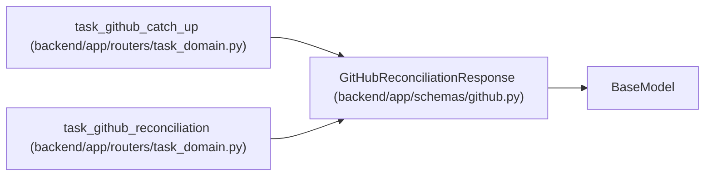

# GitHubReconciliationResponse

**Location:** `backend/app/schemas/github.py:162`
**Kind:** Pydantic model
**Bases:** `BaseModel`
**Module:** [schemas_github](../modules/schemas_github.md)

## Description

What a task submitted against what GitHub shows now, and who acts next.

## Attributes

| Name | Type | Wire name | Required | Nullable | Default | Constraints | Examples | Description |
|------|------|-----------|----------|----------|---------|-------------|-------------|----------|
| `task_id` | `int` | `task_id` | Yes | No | — | — | — | — |
| `task_status` | `str` | `task_status` | Yes | No | — | — | — | — |
| `accepted` | `bool` | `accepted` | Yes | No | — | — | — | — |
| `replacement` | `Optional[GitHubReplacementRole]` | `replacement` | No | Yes | `None` | — | — | — |
| `successor` | `Optional[GitHubSuccessor]` | `successor` | No | Yes | `None` | — | — | — |
| `pull_requests` | `list[GitHubPullReconciliation]` | `pull_requests` | No | No | factory: `list` | — | — | — |

## Methods

*No declared methods.*

## Relationships

<!-- Auto-generated relationship summary. Do not edit by hand. -->

### Summary

| Module | Methods | Attributes |
|---|---:|---|
| [schemas_github](../modules/schemas_github.md) | 0 | `accepted`, `pull_requests`, `replacement`, `successor`, `task_id`, `task_status` |

### Structure

| Kind | Entity | Module |
|---|---|---|
| Base | `BaseModel` | — |

### References

| Reference | Kind | Source | Call sites |
|---|---|---|---:|
| `task_github_catch_up` | type_reference | [routers_task_domain](../modules/routers_task_domain.md) | — |
| `task_github_reconciliation` | type_reference | [routers_task_domain](../modules/routers_task_domain.md) | — |
