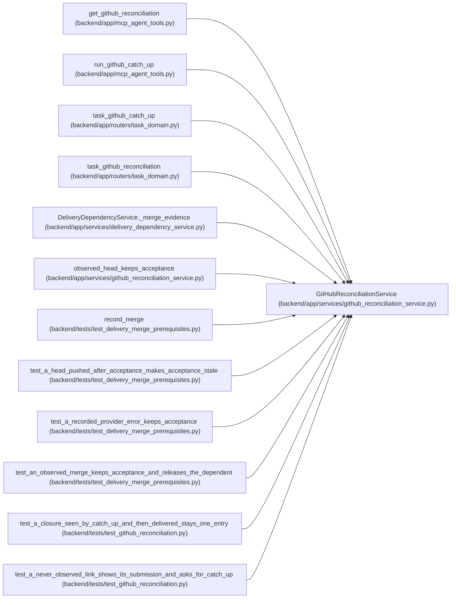

# GitHubReconciliationService

**Location:** `backend/app/services/github_reconciliation_service.py:71`
**Kind:** Class
**Bases:** —
**Module:** [github_reconciliation_service](../modules/github_reconciliation_service.md)

## Description

Read and catch up the GitHub reconciliation of one task.

## Attributes

*No annotated attributes found.*

## Methods

| Method | Signature | Decorators | Description |
|--------|-----------|------------|-------------|
| `__init__` | `(db)` | — | — |
| `_task` | *(async)* `(task_id: int, action: str) -> Task` | — | — |
| `_pull_links` | *(async)* `(task_id: int) -> list[ExternalLink]` | — | — |
| `catch_up` | *(async)* `(task_id: int) -> dict[str, Any]` | — | Refresh this task's pull request links from GitHub, then return the reconciliation. |
| `view` | *(async)* `(task_id: int) -> dict[str, Any]` | — | — |
| `_submissions` | `(link, runs, reviews, only_link)` | — | — |
| `_pull` | `(task, link, runs, reviews, accepted, replaced, relation, link_count = 1)` | — | — |
| `_next` | `(state, meta, checks_state, submitted, head_differs, accepted, replaced, relation, reviews)` | `@staticmethod` | — |

## Relationships

<!-- Auto-generated relationship summary. Do not edit by hand. -->

### Summary

| Module | Methods | Attributes |
|---|---:|---|
| [github_reconciliation_service](../modules/github_reconciliation_service.md) | 8 | — |

### References

| Reference | Kind | Source | Call sites |
|---|---|---|---:|
| `get_github_reconciliation` | call | [mcp_agent_tools](../modules/mcp_agent_tools.md) | 1 |
| `run_github_catch_up` | call | [mcp_agent_tools](../modules/mcp_agent_tools.md) | 1 |
| `task_github_catch_up` | call | [routers_task_domain](../modules/routers_task_domain.md) | 1 |
| `task_github_reconciliation` | call | [routers_task_domain](../modules/routers_task_domain.md) | 1 |
| `DeliveryDependencyService._merge_evidence` | call | [delivery_dependency_service](../modules/delivery_dependency_service.md) | 1 |
| `observed_head_keeps_acceptance` | call | [github_reconciliation_service](../modules/github_reconciliation_service.md) | 1 |
| `record_merge` | call | [test_delivery_merge_prerequisites](../modules/test_delivery_merge_prerequisites.md) | 1 |
| `test_a_head_pushed_after_acceptance_makes_acceptance_stale` | call | [test_delivery_merge_prerequisites](../modules/test_delivery_merge_prerequisites.md) | 1 |
| `test_a_recorded_provider_error_keeps_acceptance` | call | [test_delivery_merge_prerequisites](../modules/test_delivery_merge_prerequisites.md) | 1 |
| `test_an_observed_merge_keeps_acceptance_and_releases_the_dependent` | call | [test_delivery_merge_prerequisites](../modules/test_delivery_merge_prerequisites.md) | 1 |
| `test_a_closure_seen_by_catch_up_and_then_delivered_stays_one_entry` | call | [test_github_reconciliation](../modules/test_github_reconciliation.md) | 1 |
| `test_a_never_observed_link_shows_its_submission_and_asks_for_catch_up` | call | [test_github_reconciliation](../modules/test_github_reconciliation.md) | 1 |

> References: showing 12 of 21 logical references; 9 omitted by the 12-row generated summary limit.
