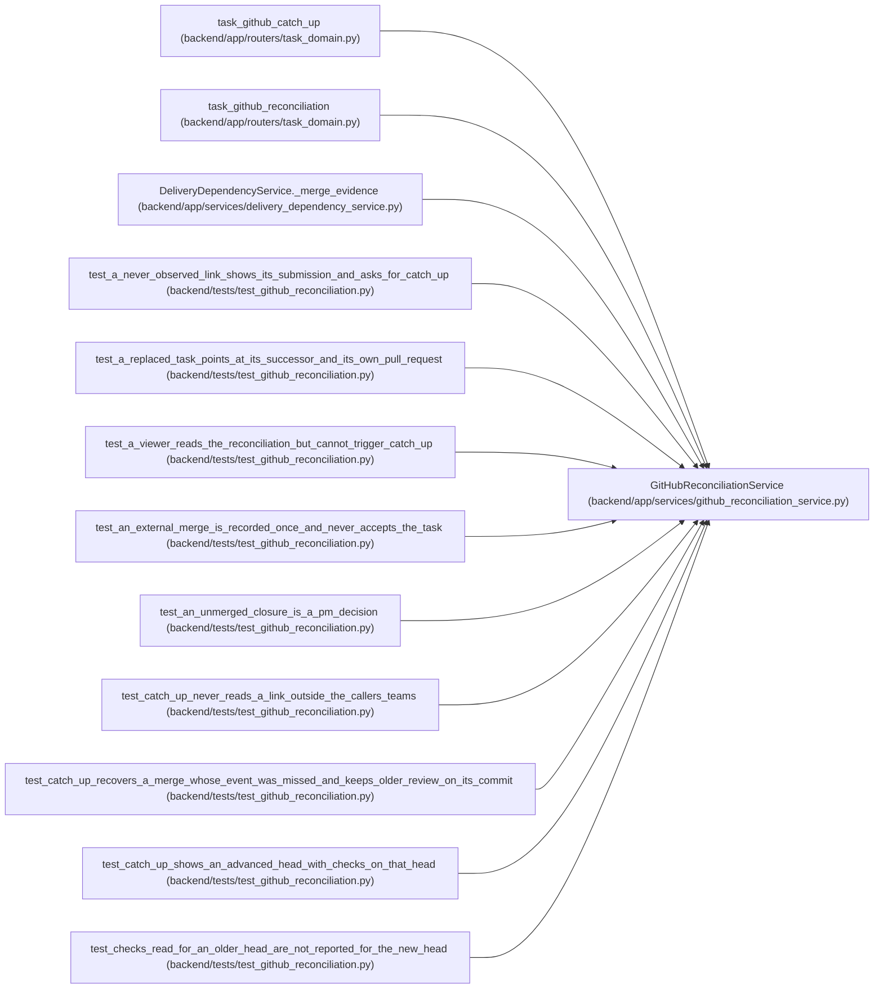

# GitHubReconciliationService

**Location:** `backend/app/services/github_reconciliation_service.py:49`
**Kind:** Class
**Bases:** —
**Module:** [github_reconciliation_service](../modules/github_reconciliation_service.md)

## Description

Read and catch up the GitHub reconciliation of one task.

## Attributes

*No annotated attributes found.*

## Methods

| Method | Signature | Decorators | Description |
|--------|-----------|------------|-------------|
| `__init__` | `(db)` | — | — |
| `_task` | *(async)* `(task_id: int, action: str) -> Task` | — | — |
| `_pull_links` | *(async)* `(task_id: int) -> list[ExternalLink]` | — | — |
| `catch_up` | *(async)* `(task_id: int) -> dict[str, Any]` | — | Refresh this task's pull request links from GitHub, then return the reconciliation. |
| `view` | *(async)* `(task_id: int) -> dict[str, Any]` | — | — |
| `_submissions` | `(link, runs, reviews, only_link)` | — | — |
| `_pull` | `(task, link, runs, reviews, accepted, replaced, relation, link_count = 1)` | — | — |
| `_next` | `(state, meta, checks_state, submitted, head_differs, accepted, replaced, relation, reviews)` | `@staticmethod` | — |

## Relationships

<!-- Auto-generated relationship summary. Do not edit by hand. -->

### Summary

| Module | Methods | Attributes |
|---|---:|---|
| [github_reconciliation_service](../modules/github_reconciliation_service.md) | 8 | — |

### References

| Reference | Kind | Source | Call sites |
|---|---|---|---:|
| `task_github_catch_up` | call | [routers_task_domain](../modules/routers_task_domain.md) | 1 |
| `task_github_reconciliation` | call | [routers_task_domain](../modules/routers_task_domain.md) | 1 |
| `DeliveryDependencyService._merge_evidence` | call | [delivery_dependency_service](../modules/delivery_dependency_service.md) | 1 |
| `test_a_never_observed_link_shows_its_submission_and_asks_for_catch_up` | call | [test_github_reconciliation](../modules/test_github_reconciliation.md) | 1 |
| `test_a_replaced_task_points_at_its_successor_and_its_own_pull_request` | call | [test_github_reconciliation](../modules/test_github_reconciliation.md) | 3 |
| `test_a_viewer_reads_the_reconciliation_but_cannot_trigger_catch_up` | call | [test_github_reconciliation](../modules/test_github_reconciliation.md) | 2 |
| `test_an_external_merge_is_recorded_once_and_never_accepts_the_task` | call | [test_github_reconciliation](../modules/test_github_reconciliation.md) | 1 |
| `test_an_unmerged_closure_is_a_pm_decision` | call | [test_github_reconciliation](../modules/test_github_reconciliation.md) | 1 |
| `test_catch_up_never_reads_a_link_outside_the_callers_teams` | call | [test_github_reconciliation](../modules/test_github_reconciliation.md) | 1 |
| `test_catch_up_recovers_a_merge_whose_event_was_missed_and_keeps_older_review_on_its_commit` | call | [test_github_reconciliation](../modules/test_github_reconciliation.md) | 1 |
| `test_catch_up_shows_an_advanced_head_with_checks_on_that_head` | call | [test_github_reconciliation](../modules/test_github_reconciliation.md) | 1 |
| `test_checks_read_for_an_older_head_are_not_reported_for_the_new_head` | call | [test_github_reconciliation](../modules/test_github_reconciliation.md) | 1 |

> References: showing 12 of 13 logical references; 1 omitted by the 12-row generated summary limit.
