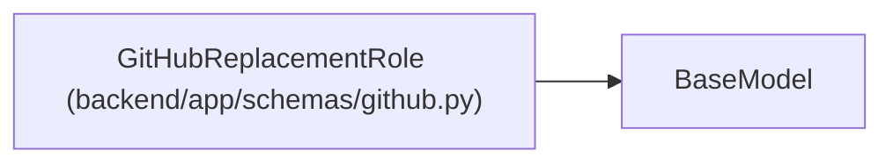

# GitHubReplacementRole

**Location:** `backend/app/schemas/github.py:146`
**Kind:** Pydantic model
**Bases:** `BaseModel`
**Module:** [schemas_github](../modules/schemas_github.md)

## Description

The replacement disposition the task takes part in.

## Attributes

| Name | Type | Wire name | Required | Nullable | Default | Constraints | Examples | Description |
|------|------|-----------|----------|----------|---------|-------------|-------------|----------|
| `role` | `Literal['original', 'replacement']` | `role` | Yes | No | — | — | — | — |
| `original_task_id` | `int` | `original_task_id` | Yes | No | — | — | — | — |
| `replacement_task_id` | `int` | `replacement_task_id` | Yes | No | — | — | — | — |

## Methods

*No declared methods.*

## Relationships

<!-- Auto-generated relationship summary. Do not edit by hand. -->

### Summary

| Module | Methods | Attributes |
|---|---:|---|
| [schemas_github](../modules/schemas_github.md) | 0 | `original_task_id`, `replacement_task_id`, `role` |

### Structure

| Kind | Entity | Module |
|---|---|---|
| Base | `BaseModel` | — |
