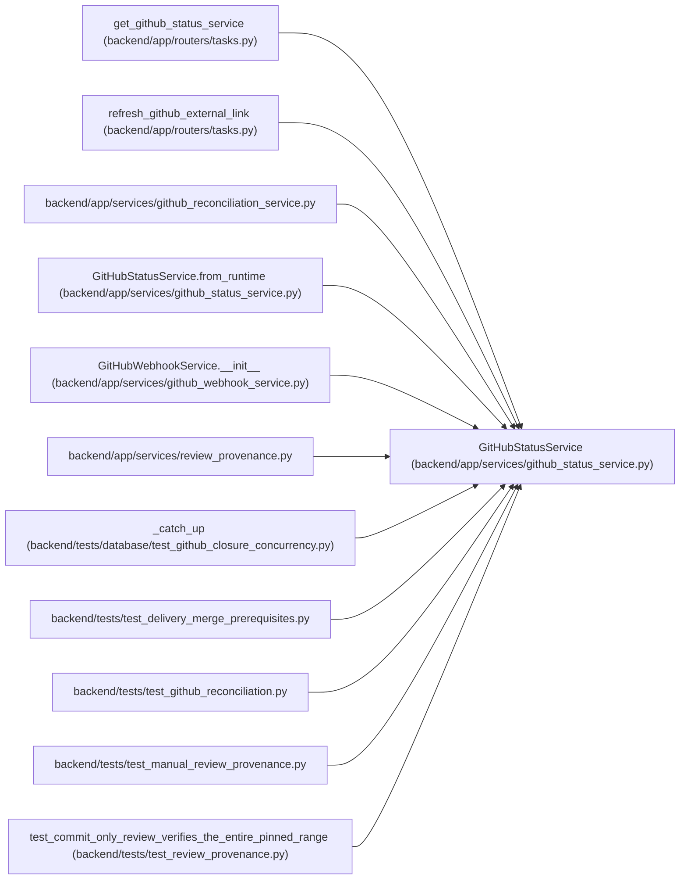

# GitHubStatusService

**Location:** `backend/app/services/github_status_service.py:61`
**Kind:** Class
**Bases:** —
**Module:** [github_status_service](../modules/github_status_service.md)

## Description

Refresh cached GitHub pull request metadata for external links.

## Attributes

*No annotated attributes found.*

## Methods

| Method | Signature | Decorators | Description |
|--------|-----------|------------|-------------|
| `__init__` | `(db: AsyncSession, settings_override = None, transport: Optional[httpx.AsyncBaseTransport] = None)` | — | — |
| `from_runtime` | *(async)* `(db: AsyncSession, transport: Optional[httpx.AsyncBaseTransport] = None) -> 'GitHubStatusService'` | `@classmethod` | Construct the service from DB-backed runtime GitHub settings. |
| `_now_iso` | `() -> str` | — | Return an API-friendly UTC timestamp. |
| `_headers` | `() -> dict[str, str]` | — | Build GitHub request headers. |
| `_pr_metadata` | `(link: ExternalLink) -> tuple[str, str, int]` | — | Extract GitHub PR identity from external link metadata. |
| `status_from_payload` | `(payload: dict[str, Any]) -> str` | — | Normalize GitHub PR state into the external link status field. |
| `observation_from_payload` | `(payload: dict[str, Any]) -> dict[str, Any]` | `@staticmethod` | The head, target and closure facts a pull request payload states. |
| `is_stale_observation` | `(metadata: dict[str, Any], payload: dict[str, Any]) -> bool` | `@staticmethod` | Whether a payload is older than what the link already records. |
| `checks_from_runs` | `(runs_payload: Any) -> dict[str, Any]` | `@staticmethod` | Summarize the check runs GitHub reports for one commit. |
| `observe_checks` | *(async)* `(owner: str, repo: str, head_sha: Any) -> dict[str, Any]` | — | Read the checks of the observed head; a read failure is recorded, not raised. |
| `observed_closure_key` | `(link_id: int, status: str, observation: dict[str, Any]) -> str` | `@staticmethod` | The identity of one merge or unmerged closure of a linked pull request. |
| `lock_link_after_task` | *(async)* `(link_id: int) -> Optional[ExternalLink]` | — | Re-read a link under a row lock, discarding any cached copy. |
| `_record_observed_closure` | *(async)* `(link: ExternalLink, status: str, observation: dict[str, Any]) -> None` | — | Record a merge or unmerged closure seen by catch-up as a GitHub task event, once. |
| `_fetch_pull_request` | *(async)* `(owner: str, repo: str, number: int) -> dict[str, Any]` | — | Fetch one pull request payload from GitHub. |
| `_fetch_pr_resource` | *(async)* `(owner, repo, number, suffix = '')` | — | — |
| `_fetch_resource` | *(async)* `(url)` | — | — |
| `_check_review_commits` | `(commits, count, expected_sha, attributed_commits, failure_context = None)` | `@staticmethod` | — |
| `verify_review_range` | *(async)* `(base, head, attributed_commits, *, failure_context = None)` | — | Verify every commit after the submitted immutable base. |
| `verify_review_head` | *(async)* `(pr, expected_sha, attributed_commits, *, expected_repository = None, failure_context = None)` | — | Observe the exact PR candidate and flag additional, unbound authors. |
| `_provider_error_message` | `(error: Exception) -> str` | — | Convert provider exceptions into a safe cached message. |
| `_save_link` | *(async)* `(link: ExternalLink) -> ExternalLink` | — | Persist changed link fields. |
| `_reserve_task_context_revision` | *(async)* `(link: ExternalLink, *, outcome: str, head_sha: Optional[str] = None) -> None` | — | Fence a task assignment before provider data dirties its linked context. |
| `fetch_pull_request` | *(async)* `(link_id: int) -> Optional[FetchedPullRequest]` | — | Read one linked pull request from GitHub while holding no lock. |
| `refresh_pull_request_status` | *(async)* `(link_id: int) -> Optional[ExternalLink]` | — | Refresh a GitHub PR link and cache status metadata. |
| `record_fetched_pull_requests` | *(async)* `(task_id: int, fetched: list[FetchedPullRequest]) -> None` | — | Record several already fetched links of one task under one task revision. |
| `apply_fetched_pull_request` | *(async)* `(fetched: FetchedPullRequest, *, reserved: bool = False) -> Optional[ExternalLink]` | — | Save a fetched observation: reserve the task context, lock the link, then write. |

## Relationships

<!-- Auto-generated relationship summary. Do not edit by hand. -->

### Summary

| Module | Methods | Attributes |
|---|---:|---|
| [github_status_service](../modules/github_status_service.md) | 26 | — |

### References

| Reference | Kind | Source | Call sites |
|---|---|---|---:|
| `get_github_status_service` | type_reference | [tasks](../modules/tasks.md) | — |
| `refresh_github_external_link` | type_reference | [tasks](../modules/tasks.md) | — |
| `github_reconciliation_service` | import | [github_reconciliation_service](../modules/github_reconciliation_service.md) | — |
| `GitHubStatusService.from_runtime` | call | [github_status_service](../modules/github_status_service.md) | 1 |
| `GitHubStatusService.from_runtime` | type_reference | [github_status_service](../modules/github_status_service.md) | — |
| `GitHubWebhookService.__init__` | call | [github_webhook_service](../modules/github_webhook_service.md) | 1 |
| `review_provenance` | import | [review_provenance](../modules/review_provenance.md) | — |
| `_catch_up` | call | [test_github_closure_concurrency](../modules/test_github_closure_concurrency.md) | 1 |
| `test_delivery_merge_prerequisites` | import | [test_delivery_merge_prerequisites](../modules/test_delivery_merge_prerequisites.md) | — |
| `test_github_reconciliation` | import | [test_github_reconciliation](../modules/test_github_reconciliation.md) | — |
| `test_manual_review_provenance` | import | [test_manual_review_provenance](../modules/test_manual_review_provenance.md) | — |
| `test_commit_only_review_verifies_the_entire_pinned_range` | call | [test_review_provenance](../modules/test_review_provenance.md) | 1 |

> References: showing 12 of 16 logical references; 4 omitted by the 12-row generated summary limit.
