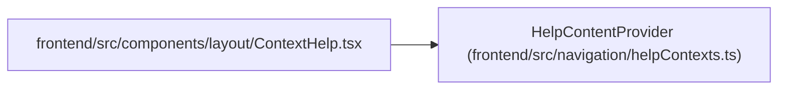

# HelpContentProvider

**Location:** `frontend/src/navigation/helpContexts.ts:10`
**Kind:** Type alias
**Bases:** —
**Module:** [helpContexts](../modules/helpContexts.md)
**Target:**

```typescript
'plan' | 'gantt' | 'tasks' | 'settings' | 'workspace'
```

## Description

_Auto-generated from `HelpContentProvider` in `frontend/src/navigation/helpContexts.ts`._

## Attributes

*See the alias definition for its member types.*

## Methods

*See the alias definition for callable and member types.*

## Relationships

<!-- Auto-generated relationship summary. Do not edit by hand. -->


### Summary

| Module | Methods | Attributes |
|---|---:|---|
| [helpContexts](../modules/helpContexts.md) | 0 | — |

### References

| Reference | Kind | Source | Call sites |
|---|---|---|---:|
| `ContextHelp` | import | [ContextHelp](../modules/ContextHelp.md) | — |
