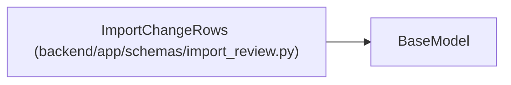

# ImportChangeRows

**Location:** `backend/app/schemas/import_review.py:8`
**Kind:** Pydantic model
**Bases:** `BaseModel`
**Module:** [import_review](../modules/import_review.md)

## Description

Rows the import creates, changes and removes.

A row the import creates is named by a stable reference such as ``new-task-1``;
existing rows keep their ids.

## Attributes

| Name | Type | Wire name | Required | Nullable | Default | Constraints | Examples | Description |
|------|------|-----------|----------|----------|---------|-------------|-------------|----------|
| `created` | `list[dict[str, Any]]` | `created` | No | No | factory: `list` | — | — | — |
| `changed` | `list[dict[str, Any]]` | `changed` | No | No | factory: `list` | — | — | — |
| `removed` | `list[dict[str, Any]]` | `removed` | No | No | factory: `list` | — | — | — |

## Methods

*No declared methods.*

## Relationships

<!-- Auto-generated relationship summary. Do not edit by hand. -->

### Summary

| Module | Methods | Attributes |
|---|---:|---|
| [import_review](../modules/import_review.md) | 0 | `changed`, `created`, `removed` |

### Structure

| Kind | Entity | Module |
|---|---|---|
| Base | `BaseModel` | — |
