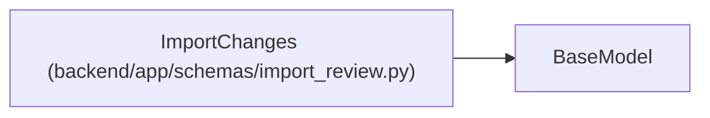

# ImportChanges

**Location:** `backend/app/schemas/import_review.py:29`
**Kind:** Pydantic model
**Bases:** `BaseModel`
**Module:** [import_review](../modules/import_review.md)

## Description

_Auto-generated from `ImportChanges` in `backend/app/schemas/import_review.py`._

## Attributes

| Name | Type | Wire name | Required | Nullable | Default | Constraints | Examples | Description |
|------|------|-----------|----------|----------|---------|-------------|-------------|----------|
| `iteration` | `Optional[dict[str, Any]]` | `iteration` | No | Yes | `None` | — | — | — |
| `tasks` | `ImportChangeRows` | `tasks` | Yes | No | — | — | — | — |
| `dependencies` | `ImportDependencyRows` | `dependencies` | Yes | No | — | — | — | — |
| `links` | `ImportChangeRows` | `links` | Yes | No | — | — | — | — |
| `dates` | `list[dict[str, Any]]` | `dates` | Yes | No | — | — | — | — |
| `team_members` | `ImportChangeRows` | `team_members` | Yes | No | — | — | — | — |
| `profiles` | `ImportProfileRows` | `profiles` | Yes | No | — | — | — | — |

## Methods

*No declared methods.*

## Relationships

<!-- Auto-generated relationship summary. Do not edit by hand. -->

### Summary

| Module | Methods | Attributes |
|---|---:|---|
| [import_review](../modules/import_review.md) | 0 | `dates`, `dependencies`, `iteration`, `links`, `profiles`, `tasks`, `team_members` |

### Structure

| Kind | Entity | Module |
|---|---|---|
| Base | `BaseModel` | — |
