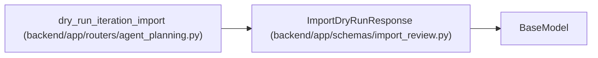

# ImportDryRunResponse

**Location:** `backend/app/schemas/import_review.py:39`
**Kind:** Pydantic model
**Bases:** `BaseModel`
**Module:** [import_review](../modules/import_review.md)

## Description

The exact change set of one import file; nothing was written.

## Attributes

| Name | Type | Wire name | Required | Nullable | Default | Constraints | Examples | Description |
|------|------|-----------|----------|----------|---------|-------------|-------------|----------|
| `target_iteration_id` | `Optional[int]` | `target_iteration_id` | Yes | Yes | — | — | — | — |
| `file_sha256` | `str` | `file_sha256` | Yes | No | — | — | — | — |
| `expected_revisions` | `dict[str, int]` | `expected_revisions` | Yes | No | — | — | — | — |
| `changes` | `ImportChanges` | `changes` | Yes | No | — | — | — | — |
| `summary` | `dict[str, int]` | `summary` | Yes | No | — | — | — | — |
| `review_digest` | `str` | `review_digest` | Yes | No | — | — | — | — |
| `written` | `Literal[False]` | `written` | Yes | No | — | — | — | — |

## Methods

*No declared methods.*

## Relationships

<!-- Auto-generated relationship summary. Do not edit by hand. -->

### Summary

| Module | Methods | Attributes |
|---|---:|---|
| [import_review](../modules/import_review.md) | 0 | `changes`, `expected_revisions`, `file_sha256`, `review_digest`, `summary`, `target_iteration_id`, `written` |

### Structure

| Kind | Entity | Module |
|---|---|---|
| Base | `BaseModel` | — |

### References

| Reference | Kind | Source | Call sites |
|---|---|---|---:|
| `dry_run_iteration_import` | type_reference | [routers_agent_planning](../modules/routers_agent_planning.md) | — |
