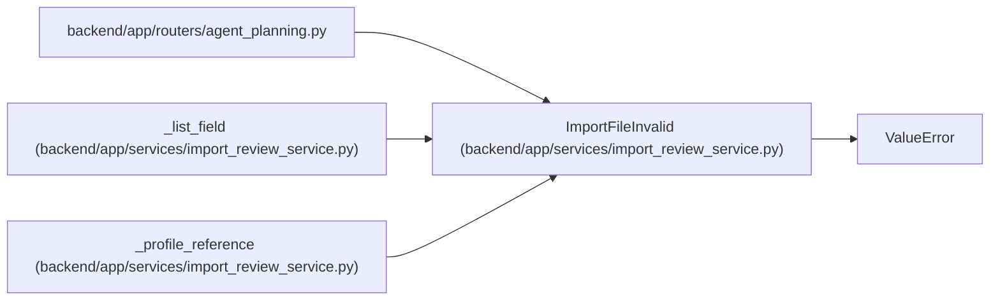

# ImportFileInvalid

**Location:** `backend/app/services/import_review_service.py:69`
**Kind:** Class
**Bases:** `ValueError`
**Module:** [import_review_service](../modules/import_review_service.md)

## Description

An import file field has the wrong type.

## Attributes

*No annotated attributes found.*

## Methods

| Method | Signature | Decorators | Description |
|--------|-----------|------------|-------------|
| `detail` | `()` | — | — |

## Relationships

<!-- Auto-generated relationship summary. Do not edit by hand. -->

### Summary

| Module | Methods | Attributes |
|---|---:|---|
| [import_review_service](../modules/import_review_service.md) | 1 | — |

### Structure

| Kind | Entity | Module |
|---|---|---|
| Base | `ValueError` | — |

### References

| Reference | Kind | Source | Call sites |
|---|---|---|---:|
| `agent_planning` | import | [routers_agent_planning](../modules/routers_agent_planning.md) | — |
| `_list_field` | call | [import_review_service](../modules/import_review_service.md) | 1 |
| `_profile_reference` | call | [import_review_service](../modules/import_review_service.md) | 2 |
