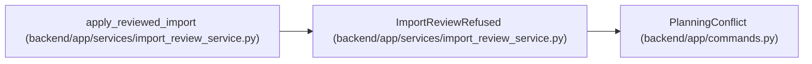

# ImportReviewRefused

**Location:** `backend/app/services/import_review_service.py:76`
**Kind:** Class
**Bases:** `PlanningConflict`
**Module:** [import_review_service](../modules/import_review_service.md)

## Description

A reviewed import no longer matches what the reviewer saw.

## Attributes

*No annotated attributes found.*

## Methods

*No declared methods.*

## Relationships

<!-- Auto-generated relationship summary. Do not edit by hand. -->

### Summary

| Module | Methods | Attributes |
|---|---:|---|
| [import_review_service](../modules/import_review_service.md) | 0 | — |

### Structure

| Kind | Entity | Module |
|---|---|---|
| Base | `PlanningConflict` | [commands](../modules/commands.md) |

### References

| Reference | Kind | Source | Call sites |
|---|---|---|---:|
| `apply_reviewed_import` | call | [import_review_service](../modules/import_review_service.md) | 4 |
