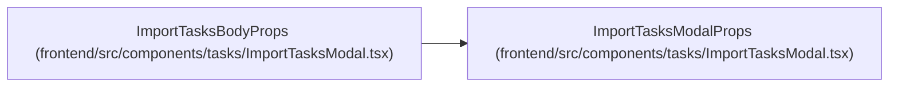

# ImportTasksBodyProps

**Location:** `frontend/src/components/tasks/ImportTasksModal.tsx:29`
**Kind:** Interface
**Bases:** `ImportTasksModalProps`
**Module:** [ImportTasksModal](../modules/ImportTasksModal.md)

## Description

_Auto-generated from `ImportTasksBodyProps` in `frontend/src/components/tasks/ImportTasksModal.tsx`._

## Attributes

| Name | Type | Required | Default | Description |
|------|------|----------|---------|-------------|
| `initialRevision` | `number` | No | — | — |
| `isLoading` | `boolean` | Yes | — | — |
| `queryError` | `unknown` | Yes | — | — |
| `unsupported` | `boolean` | Yes | — | — |
| `onRetry` | `() => void` | Yes | — | — |

## Methods

*No declared methods.*

## Relationships

<!-- Auto-generated relationship summary. Do not edit by hand. -->

### Summary

| Module | Methods | Attributes |
|---|---:|---|
| [ImportTasksModal](../modules/ImportTasksModal.md) | 0 | `initialRevision`, `isLoading`, `onRetry`, `queryError`, `unsupported` |

### Structure

| Kind | Entity | Module |
|---|---|---|
| Base | `ImportTasksModalProps` | [ImportTasksModal](../modules/ImportTasksModal.md) |
