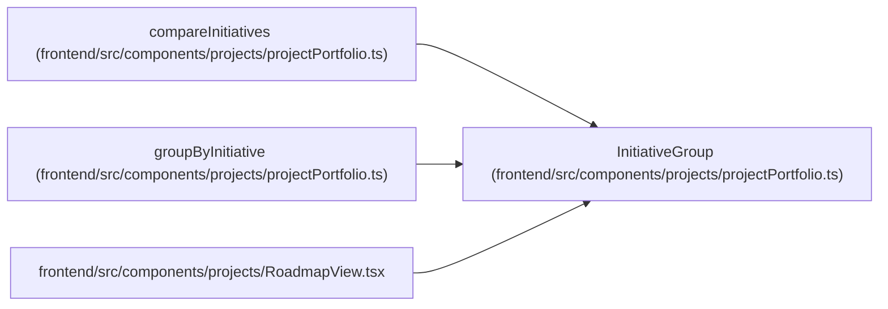

# InitiativeGroup

**Location:** `frontend/src/components/projects/projectPortfolio.ts:113`
**Kind:** Type alias
**Bases:** —
**Module:** [projectPortfolio](../modules/projectPortfolio.md)
**Target:**

```typescript
{
    key: string;
    /** Null for the projects that belong to no initiative. */
    initiative: InitiativeGroupInfo | null;
    items: T[];
}
```
**Type parameters:** `T`

## Description

_Auto-generated from `InitiativeGroup` in `frontend/src/components/projects/projectPortfolio.ts`._

## Attributes

*See the alias definition for its member types.*

## Methods

*See the alias definition for callable and member types.*

## Relationships

<!-- Auto-generated relationship summary. Do not edit by hand. -->


### Summary

| Module | Methods | Attributes |
|---|---:|---|
| [projectPortfolio](../modules/projectPortfolio.md) | 0 | — |

### References

| Reference | Kind | Source | Call sites |
|---|---|---|---:|
| `compareInitiatives` | type_reference | [projectPortfolio](../modules/projectPortfolio.md) | — |
| `groupByInitiative` | type_reference | [projectPortfolio](../modules/projectPortfolio.md) | — |
| `RoadmapView` | import | [RoadmapView](../modules/RoadmapView.md) | — |
