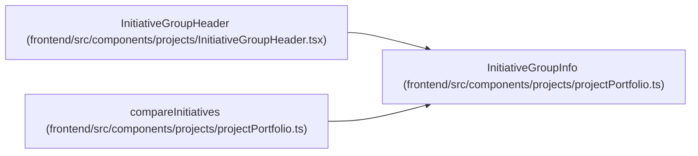

# InitiativeGroupInfo

**Location:** `frontend/src/components/projects/projectPortfolio.ts:108`
**Kind:** Type alias
**Bases:** —
**Module:** [projectPortfolio](../modules/projectPortfolio.md)
**Target:**

```typescript
Pick<
    Initiative,
    'id' | 'name' | 'owner_id' | 'owner' | 'owner_profile_id' | 'owner_profile' | 'health' | 'target_date'
> & Partial<Pick<Initiative, 'description'>>
```

## Description

_Auto-generated from `InitiativeGroupInfo` in `frontend/src/components/projects/projectPortfolio.ts`._

## Attributes

*See the alias definition for its member types.*

## Methods

*See the alias definition for callable and member types.*

## Relationships

<!-- Auto-generated relationship summary. Do not edit by hand. -->


### Summary

| Module | Methods | Attributes |
|---|---:|---|
| [projectPortfolio](../modules/projectPortfolio.md) | 0 | — |

### References

| Reference | Kind | Source | Call sites |
|---|---|---|---:|
| `InitiativeGroupHeader` | type_reference | [InitiativeGroupHeader](../modules/InitiativeGroupHeader.md) | — |
| `compareInitiatives` | type_reference | [projectPortfolio](../modules/projectPortfolio.md) | — |
