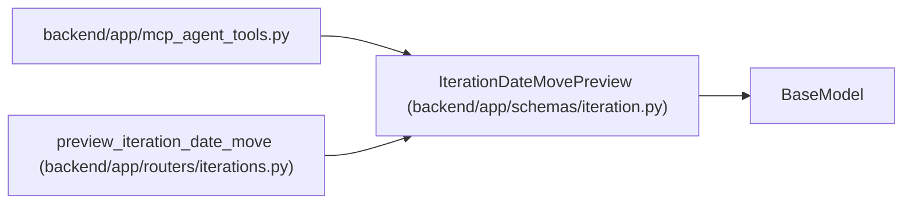

# IterationDateMovePreview

**Location:** `backend/app/schemas/iteration.py:249`
**Kind:** Pydantic model
**Bases:** `BaseModel`
**Module:** [schemas_iteration](../modules/schemas_iteration.md)

## Description

Shared capacity for a proposed iteration period. Nothing is saved.

## Attributes

| Name | Type | Wire name | Required | Nullable | Default | Constraints | Examples | Description |
|------|------|-----------|----------|----------|---------|-------------|-------------|----------|
| `applied` | `bool` | `applied` | No | No | `False` | — | — | — |
| `iteration_id` | `int` | `iteration_id` | Yes | No | — | — | — | — |
| `current` | `IterationPeriod` | `current` | Yes | No | — | — | — | — |
| `proposed` | `IterationPeriod` | `proposed` | Yes | No | — | — | — | — |
| `profiles` | `list[DateMoveProfile]` | `profiles` | Yes | No | — | — | — | — |
| `shortfalls` | `list[DateMoveShortfall]` | `shortfalls` | Yes | No | — | — | — | — |
| `shortfalls_truncated` | `bool` | `shortfalls_truncated` | No | No | `False` | — | — | — |
| `max_shortfalls` | `int` | `max_shortfalls` | Yes | No | — | — | — | — |
| `unlinked_member_ids` | `list[int]` | `unlinked_member_ids` | No | No | factory: `list` | — | — | — |
| `expected_revisions` | `dict[int, int]` | `expected_revisions` | Yes | No | — | — | — | — |
| `planning_revision` | `Optional[int]` | `planning_revision` | No | Yes | `None` | — | — | — |
| `apply_with` | `str` | `apply_with` | No | No | `'Update the iteration with the same start_date, end_date and calendar fields and these expected_revisions; a changed iteration is refused. Bookings in other iterations are not fenced by that update: preview again if planning_revision has changed.'` | — | — | — |
| `formula` | `str` | `formula` | No | No | `"requested = this iteration's capacity rows: person calendar hours after absence × the row's percentage on that date; booked elsewhere = the same for every other row of the person; overallocated = requested + booked elsewhere − available; shortfall = min(requested, overallocated)"` | — | — | — |

## Methods

*No declared methods.*

## Relationships

<!-- Auto-generated relationship summary. Do not edit by hand. -->

### Summary

| Module | Methods | Attributes |
|---|---:|---|
| [schemas_iteration](../modules/schemas_iteration.md) | 0 | `applied`, `apply_with`, `current`, `expected_revisions`, `formula`, `iteration_id`, `max_shortfalls`, `planning_revision`, `profiles`, `proposed`, `shortfalls`, `shortfalls_truncated` |

### Structure

| Kind | Entity | Module |
|---|---|---|
| Base | `BaseModel` | — |

### References

| Reference | Kind | Source | Call sites |
|---|---|---|---:|
| `mcp_agent_tools` | import | [mcp_agent_tools](../modules/mcp_agent_tools.md) | — |
| `preview_iteration_date_move` | type_reference | [iterations](../modules/iterations.md) | — |
