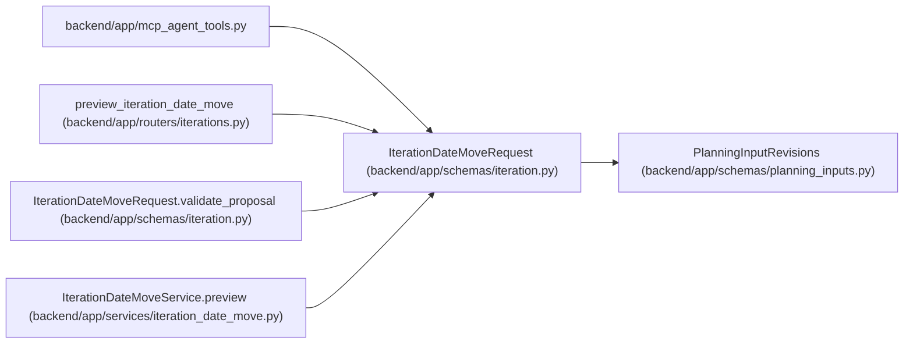

# IterationDateMoveRequest

**Location:** `backend/app/schemas/iteration.py:176`
**Kind:** Class
**Bases:** `PlanningInputRevisions`
**Module:** [schemas_iteration](../modules/schemas_iteration.md)

## Description

A proposed iteration start, end and calendar to check against shared capacity.

## Validators

| Method | Scope | Fields | Mode | Options |
|--------|-------|--------|------|---------|
| `validate_proposal` | model | — | after | — |

## Attributes

| Name | Type | Wire name | Required | Nullable | Default | Constraints | Examples | Description |
|------|------|-----------|----------|----------|---------|-------------|-------------|----------|
| `start_date` | `Optional[date]` | `start_date` | No | Yes | `None` | — | — | — |
| `end_date` | `Optional[date]` | `end_date` | No | Yes | `None` | — | — | — |
| `calendar_id` | `Optional[int]` | `calendar_id` | No | Yes | `None` | — | — | — |
| `additional_calendar_ids` | `list[int] \| None` | `additional_calendar_ids` | No | Yes | `None` | max_length=100 | — | — |

## Methods

| Method | Signature | Decorators | Description |
|--------|-----------|------------|-------------|
| `validate_proposal` | `() -> 'IterationDateMoveRequest'` | `@model_validator(mode='after')` | — |
| `as_update` | `() -> IterationUpdate` | — | The iteration update that applies this proposal. |

## Relationships

<!-- Auto-generated relationship summary. Do not edit by hand. -->

### Summary

| Module | Methods | Attributes |
|---|---:|---|
| [schemas_iteration](../modules/schemas_iteration.md) | 2 | `additional_calendar_ids`, `calendar_id`, `end_date`, `start_date` |

### Structure

| Kind | Entity | Module |
|---|---|---|
| Base | `PlanningInputRevisions` | [planning_inputs](../modules/planning_inputs.md) |

### References

| Reference | Kind | Source | Call sites |
|---|---|---|---:|
| `mcp_agent_tools` | import | [mcp_agent_tools](../modules/mcp_agent_tools.md) | — |
| `preview_iteration_date_move` | type_reference | [iterations](../modules/iterations.md) | — |
| `IterationDateMoveRequest.validate_proposal` | type_reference | [schemas_iteration](../modules/schemas_iteration.md) | — |
| `IterationDateMoveService.preview` | type_reference | [iteration_date_move](../modules/iteration_date_move.md) | — |
