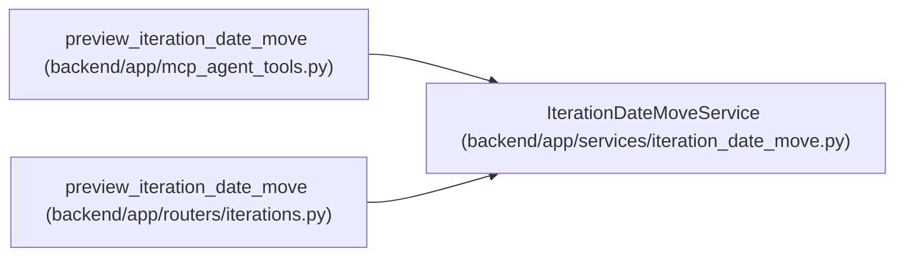

# IterationDateMoveService

**Location:** `backend/app/services/iteration_date_move.py:44`
**Kind:** Class
**Bases:** —
**Module:** [iteration_date_move](../modules/iteration_date_move.md)

## Description

Calculate shared capacity for a proposed iteration period, then roll everything back.

## Attributes

*No annotated attributes found.*

## Methods

| Method | Signature | Decorators | Description |
|--------|-----------|------------|-------------|
| `__init__` | `(db)` | — | — |
| `preview` | *(async)* `(iteration_id: int, data: IterationDateMoveRequest)` | `@preview_command` | — |
| `_period` | `(iteration)` | — | — |
| `_row_hours` | *(async)* `(profile_id, iteration_id, start, end)` | — | Return a function giving this iteration's and the other rows' hours of one person on a date. |

## Relationships

<!-- Auto-generated relationship summary. Do not edit by hand. -->

### Summary

| Module | Methods | Attributes |
|---|---:|---|
| [iteration_date_move](../modules/iteration_date_move.md) | 4 | — |

### References

| Reference | Kind | Source | Call sites |
|---|---|---|---:|
| `preview_iteration_date_move` | call | [mcp_agent_tools](../modules/mcp_agent_tools.md) | 1 |
| `preview_iteration_date_move` | call | [iterations](../modules/iterations.md) | 1 |
