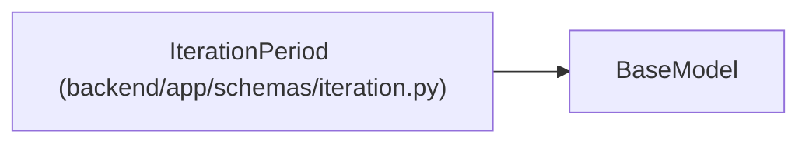

# IterationPeriod

**Location:** `backend/app/schemas/iteration.py:201`
**Kind:** Pydantic model
**Bases:** `BaseModel`
**Module:** [schemas_iteration](../modules/schemas_iteration.md)

## Description

An iteration's dates and annual calendars.

## Attributes

| Name | Type | Wire name | Required | Nullable | Default | Constraints | Examples | Description |
|------|------|-----------|----------|----------|---------|-------------|-------------|----------|
| `start_date` | `date` | `start_date` | Yes | No | — | — | — | — |
| `end_date` | `date` | `end_date` | Yes | No | — | — | — | — |
| `calendar_id` | `int` | `calendar_id` | Yes | No | — | — | — | — |
| `additional_calendar_ids` | `list[int]` | `additional_calendar_ids` | No | No | factory: `list` | — | — | — |
| `working_days` | `int` | `working_days` | Yes | No | — | — | — | — |
| `missing_calendar_years` | `list[int]` | `missing_calendar_years` | No | No | factory: `list` | — | — | — |

## Methods

*No declared methods.*

## Relationships

<!-- Auto-generated relationship summary. Do not edit by hand. -->

### Summary

| Module | Methods | Attributes |
|---|---:|---|
| [schemas_iteration](../modules/schemas_iteration.md) | 0 | `additional_calendar_ids`, `calendar_id`, `end_date`, `missing_calendar_years`, `start_date`, `working_days` |

### Structure

| Kind | Entity | Module |
|---|---|---|
| Base | `BaseModel` | — |
