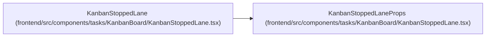

# KanbanStoppedLaneProps

**Location:** `frontend/src/components/tasks/KanbanBoard/KanbanStoppedLane.tsx:10`
**Kind:** Interface
**Bases:** —
**Module:** [KanbanStoppedLane](../modules/KanbanStoppedLane.md)

## Description

_Auto-generated from `KanbanStoppedLaneProps` in `frontend/src/components/tasks/KanbanBoard/KanbanStoppedLane.tsx`._

## Attributes

| Name | Type | Required | Default | Description |
|------|------|----------|---------|-------------|
| `kind` | `'postponed' \| 'ended'` | Yes | — | — |
| `tasks` | `Task[]` | Yes | — | — |
| `defaultOpen` | `boolean` | No | — | — |
| `onOpen` | `(task: Task, trigger?: HTMLElement) => void` | Yes | — | — |
| `onOpenTask` | `(taskId: number) => void` | Yes | — | — |

## Methods

*No declared methods.*

## Relationships

<!-- Auto-generated relationship summary. Do not edit by hand. -->

### Summary

| Module | Methods | Attributes |
|---|---:|---|
| [KanbanStoppedLane](../modules/KanbanStoppedLane.md) | 0 | `defaultOpen`, `kind`, `onOpen`, `onOpenTask`, `tasks` |

### References

| Reference | Kind | Source | Call sites |
|---|---|---|---:|
| `KanbanStoppedLane` | type_reference | [KanbanStoppedLane](../modules/KanbanStoppedLane.md) | — |
