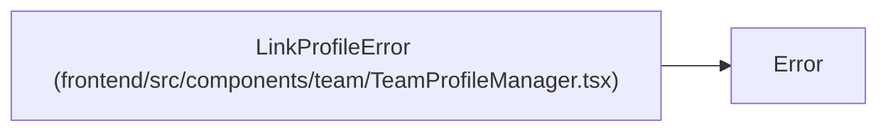

# LinkProfileError

**Location:** `frontend/src/components/team/TeamProfileManager.tsx:322`
**Kind:** Class
**Bases:** `Error`
**Module:** [TeamProfileManager](../modules/TeamProfileManager.md)

## Description

_Auto-generated from `LinkProfileError` in `frontend/src/components/team/TeamProfileManager.tsx`._

## Attributes

*No annotated attributes found.*

## Methods

| Method | Signature | Decorators | Description |
|--------|-----------|------------|-------------|
| `constructor` | `(cause: unknown)` | — | — |

## Relationships

<!-- Auto-generated relationship summary. Do not edit by hand. -->

### Summary

| Module | Methods | Attributes |
|---|---:|---|
| [TeamProfileManager](../modules/TeamProfileManager.md) | 1 | — |

### Structure

| Kind | Entity | Module |
|---|---|---|
| Base | `Error` | — |
