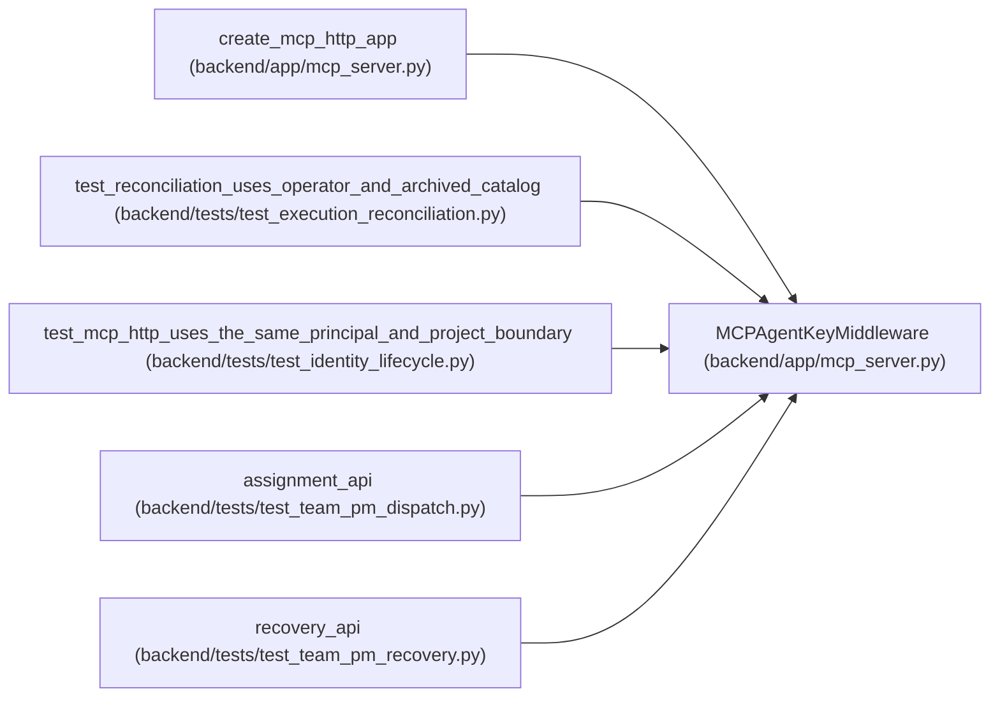

# MCPAgentKeyMiddleware

**Location:** `backend/app/mcp_server.py:110`
**Kind:** Class
**Bases:** —
**Module:** [mcp_server](../modules/mcp_server.md)

## Description

Extract and validate MCP HTTP agent credentials before protocol handling.

## Attributes

*No annotated attributes found.*

## Methods

| Method | Signature | Decorators | Description |
|--------|-----------|------------|-------------|
| `__init__` | `(app: ASGIApp)` | — | — |
| `__call__` | *(async)* `(scope: Scope, receive: Receive, send: Send) -> None` | — | — |

## Relationships

<!-- Auto-generated relationship summary. Do not edit by hand. -->

### Summary

| Module | Methods | Attributes |
|---|---:|---|
| [mcp_server](../modules/mcp_server.md) | 2 | — |

### References

| Reference | Kind | Source | Call sites |
|---|---|---|---:|
| `create_mcp_http_app` | call | [mcp_server](../modules/mcp_server.md) | 1 |
| `test_reconciliation_uses_operator_and_archived_catalog` | call | [test_execution_reconciliation](../modules/test_execution_reconciliation.md) | 2 |
| `test_mcp_http_uses_the_same_principal_and_project_boundary` | call | [test_identity_lifecycle](../modules/test_identity_lifecycle.md) | 1 |
| `assignment_api` | call | [test_team_pm_dispatch](../modules/test_team_pm_dispatch.md) | 1 |
| `recovery_api` | call | [test_team_pm_recovery](../modules/test_team_pm_recovery.md) | 1 |
