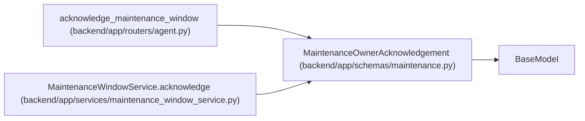

# MaintenanceOwnerAcknowledgement

**Location:** `backend/app/schemas/maintenance.py:49`
**Kind:** Pydantic model
**Bases:** `BaseModel`
**Module:** [schemas_maintenance](../modules/schemas_maintenance.md)

## Description

The live claim owner's acknowledgement, bound to its current fence.

## Model Configuration

| Setting | Value | Source |
|---------|-------|--------|
| `extra` | `'forbid'` | model_config |

## Attributes

| Name | Type | Wire name | Required | Nullable | Default | Constraints | Examples | Description |
|------|------|-----------|----------|----------|---------|-------------|-------------|----------|
| `task_id` | `int` | `task_id` | Yes | No | — | ge=1 | — | — |
| `claim_id` | `str` | `claim_id` | Yes | No | — | min_length=16; max_length=64 | — | — |
| `claim_generation` | `int` | `claim_generation` | Yes | No | — | ge=1 | — | — |
| `run_id` | `Optional[int]` | `run_id` | No | Yes | `None` | ge=1 | — | — |

## Methods

*No declared methods.*

## Relationships

<!-- Auto-generated relationship summary. Do not edit by hand. -->

### Summary

| Module | Methods | Attributes |
|---|---:|---|
| [schemas_maintenance](../modules/schemas_maintenance.md) | 0 | `claim_generation`, `claim_id`, `run_id`, `task_id` |

### Structure

| Kind | Entity | Module |
|---|---|---|
| Base | `BaseModel` | — |

### References

| Reference | Kind | Source | Call sites |
|---|---|---|---:|
| `acknowledge_maintenance_window` | type_reference | [routers_agent](../modules/routers_agent.md) | — |
| `MaintenanceWindowService.acknowledge` | type_reference | [maintenance_window_service](../modules/maintenance_window_service.md) | — |
