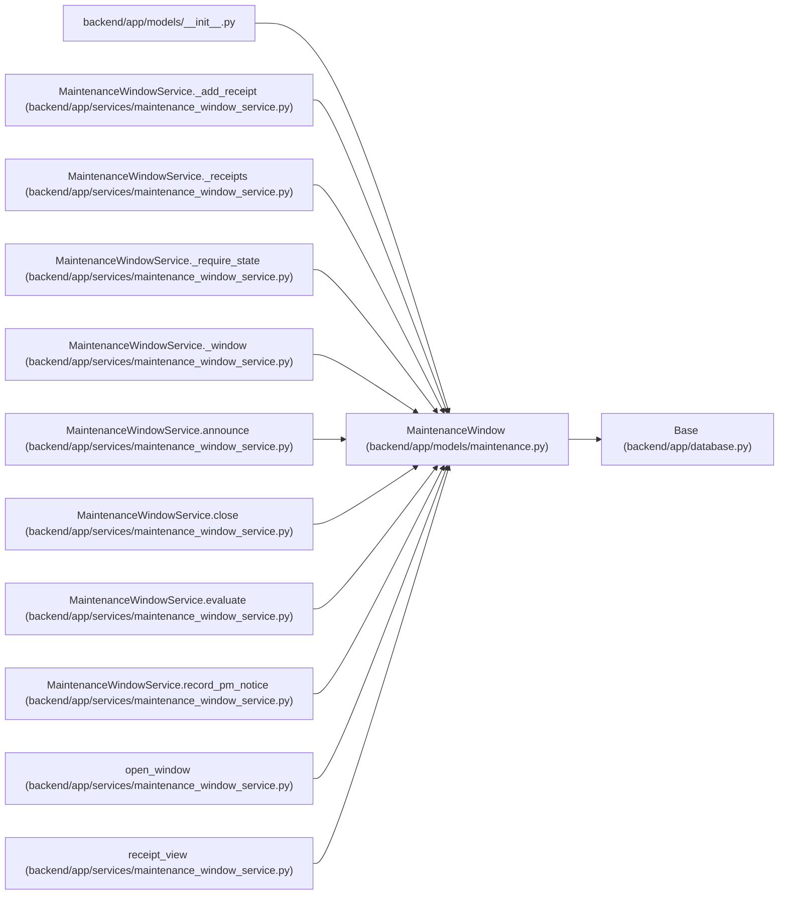

# MaintenanceWindow

**Location:** `backend/app/models/maintenance.py:13`
**Kind:** Class
**Bases:** `Base`
**Module:** [models_maintenance](../modules/models_maintenance.md)

## Description

One bounded deployment window an operator announces, begins, and closes.

``active_slot`` is 1 only while the window is announced or in progress, so a
unique constraint allows at most one open window on every database.

## Attributes

| Name | Type | Default | Description |
|------|------|---------|-------------|
| `id` | `Mapped[int]` | `mapped_column(Integer, primary_key=True, autoincrement=True)` | — |
| `state` | `Mapped[str]` | `mapped_column(String(20), nullable=False, default='announced')` | — |
| `active_slot` | `Mapped[Optional[int]]` | `mapped_column(Integer, nullable=True, default=1)` | — |
| `release_label` | `Mapped[str]` | `mapped_column(String(120), nullable=False)` | — |
| `reason` | `Mapped[str]` | `mapped_column(Text, nullable=False)` | — |
| `planned_start_at` | `Mapped[datetime]` | `mapped_column(UTCDateTime(), nullable=False)` | — |
| `planned_end_at` | `Mapped[datetime]` | `mapped_column(UTCDateTime(), nullable=False)` | — |
| `max_outage_seconds` | `Mapped[int]` | `mapped_column(Integer, nullable=False)` | — |
| `expiry_margin_seconds` | `Mapped[int]` | `mapped_column(Integer, nullable=False)` | — |
| `announced_by_principal_id` | `Mapped[Optional[int]]` | `mapped_column(Integer, ForeignKey('principals.id', ondelete='SET NULL'), nullable=True)` | — |
| `announced_at` | `Mapped[datetime]` | `mapped_column(UTCDateTime(), nullable=False, default=utc_now)` | — |
| `started_at` | `Mapped[Optional[datetime]]` | `mapped_column(UTCDateTime(), nullable=True)` | — |
| `ended_at` | `Mapped[Optional[datetime]]` | `mapped_column(UTCDateTime(), nullable=True)` | — |
| `outcome` | `Mapped[Optional[str]]` | `mapped_column(String(20), nullable=True)` | — |
| `closing_note` | `Mapped[Optional[str]]` | `mapped_column(Text, nullable=True)` | — |
| `protected_claims` | `Mapped[Optional[list[Any]]]` | `mapped_column(JSON(none_as_null=True), nullable=True)` | — |
| `resumption` | `Mapped[Optional[dict[str, Any]]]` | `mapped_column(JSON(none_as_null=True), nullable=True)` | — |

## Methods

*No declared methods.*

## Relationships

<!-- Auto-generated relationship summary. Do not edit by hand. -->

### Summary

| Module | Methods | Attributes |
|---|---:|---|
| [models_maintenance](../modules/models_maintenance.md) | 0 | `active_slot`, `announced_at`, `announced_by_principal_id`, `closing_note`, `ended_at`, `expiry_margin_seconds`, `id`, `max_outage_seconds`, `outcome`, `planned_end_at`, `planned_start_at`, `protected_claims` |

### Structure

| Kind | Entity | Module |
|---|---|---|
| Base | `Base` | [app_database](../modules/app_database.md) |

### References

| Reference | Kind | Source | Call sites |
|---|---|---|---:|
| `__init__` | import | [models___init__](../modules/models___init__.md) | — |
| `MaintenanceWindowService._add_receipt` | type_reference | [maintenance_window_service](../modules/maintenance_window_service.md) | — |
| `MaintenanceWindowService._receipts` | type_reference | [maintenance_window_service](../modules/maintenance_window_service.md) | — |
| `MaintenanceWindowService._require_state` | type_reference | [maintenance_window_service](../modules/maintenance_window_service.md) | — |
| `MaintenanceWindowService._window` | type_reference | [maintenance_window_service](../modules/maintenance_window_service.md) | — |
| `MaintenanceWindowService.announce` | call | [maintenance_window_service](../modules/maintenance_window_service.md) | 1 |
| `MaintenanceWindowService.announce` | type_reference | [maintenance_window_service](../modules/maintenance_window_service.md) | — |
| `MaintenanceWindowService.close` | type_reference | [maintenance_window_service](../modules/maintenance_window_service.md) | — |
| `MaintenanceWindowService.evaluate` | type_reference | [maintenance_window_service](../modules/maintenance_window_service.md) | — |
| `MaintenanceWindowService.record_pm_notice` | type_reference | [maintenance_window_service](../modules/maintenance_window_service.md) | — |
| `open_window` | type_reference | [maintenance_window_service](../modules/maintenance_window_service.md) | — |
| `receipt_view` | type_reference | [maintenance_window_service](../modules/maintenance_window_service.md) | — |

> References: showing 12 of 14 logical references; 2 omitted by the 12-row generated summary limit.
