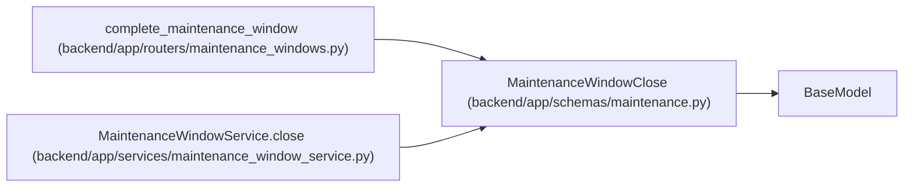

# MaintenanceWindowClose

**Location:** `backend/app/schemas/maintenance.py:32`
**Kind:** Pydantic model
**Bases:** `BaseModel`
**Module:** [schemas_maintenance](../modules/schemas_maintenance.md)

## Description

Close a begun window after the restart, or after a rollback.

## Model Configuration

| Setting | Value | Source |
|---------|-------|--------|
| `extra` | `'forbid'` | model_config |

## Attributes

| Name | Type | Wire name | Required | Nullable | Default | Constraints | Examples | Description |
|------|------|-----------|----------|----------|---------|-------------|-------------|----------|
| `outcome` | `Literal['completed', 'rolled_back']` | `outcome` | Yes | No | — | — | — | — |
| `note` | `Optional[str]` | `note` | No | Yes | `None` | max_length=4000 | — | — |

## Methods

*No declared methods.*

## Relationships

<!-- Auto-generated relationship summary. Do not edit by hand. -->

### Summary

| Module | Methods | Attributes |
|---|---:|---|
| [schemas_maintenance](../modules/schemas_maintenance.md) | 0 | `note`, `outcome` |

### Structure

| Kind | Entity | Module |
|---|---|---|
| Base | `BaseModel` | — |

### References

| Reference | Kind | Source | Call sites |
|---|---|---|---:|
| `complete_maintenance_window` | type_reference | [maintenance_windows](../modules/maintenance_windows.md) | — |
| `MaintenanceWindowService.close` | type_reference | [maintenance_window_service](../modules/maintenance_window_service.md) | — |
