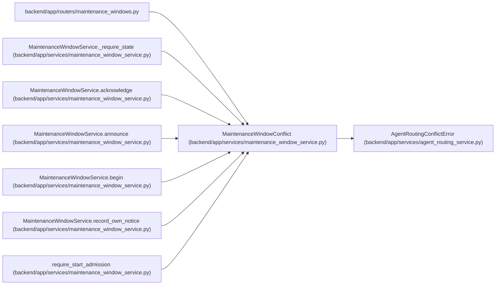

# MaintenanceWindowConflict

**Location:** `backend/app/services/maintenance_window_service.py:41`
**Kind:** Class
**Bases:** `AgentRoutingConflictError`
**Module:** [maintenance_window_service](../modules/maintenance_window_service.md)

## Description

A stable, structured maintenance refusal shared by REST and MCP.

## Attributes

*No annotated attributes found.*

## Methods

*No declared methods.*

## Relationships

<!-- Auto-generated relationship summary. Do not edit by hand. -->

### Summary

| Module | Methods | Attributes |
|---|---:|---|
| [maintenance_window_service](../modules/maintenance_window_service.md) | 0 | — |

### Structure

| Kind | Entity | Module |
|---|---|---|
| Base | `AgentRoutingConflictError` | [agent_routing_service](../modules/agent_routing_service.md) |

### References

| Reference | Kind | Source | Call sites |
|---|---|---|---:|
| `maintenance_windows` | import | [maintenance_windows](../modules/maintenance_windows.md) | — |
| `MaintenanceWindowService._require_state` | call | [maintenance_window_service](../modules/maintenance_window_service.md) | 1 |
| `MaintenanceWindowService.acknowledge` | call | [maintenance_window_service](../modules/maintenance_window_service.md) | 2 |
| `MaintenanceWindowService.announce` | call | [maintenance_window_service](../modules/maintenance_window_service.md) | 2 |
| `MaintenanceWindowService.begin` | call | [maintenance_window_service](../modules/maintenance_window_service.md) | 1 |
| `MaintenanceWindowService.record_own_notice` | call | [maintenance_window_service](../modules/maintenance_window_service.md) | 1 |
| `require_start_admission` | call | [maintenance_window_service](../modules/maintenance_window_service.md) | 1 |
