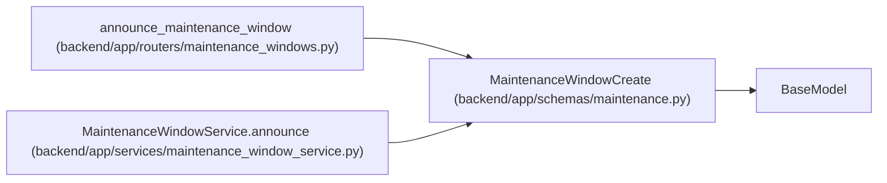

# MaintenanceWindowCreate

**Location:** `backend/app/schemas/maintenance.py:9`
**Kind:** Pydantic model
**Bases:** `BaseModel`
**Module:** [schemas_maintenance](../modules/schemas_maintenance.md)

## Description

Announce one bounded window; it closes admission for new work at once.

## Model Configuration

| Setting | Value | Source |
|---------|-------|--------|
| `extra` | `'forbid'` | model_config |

## Attributes

| Name | Type | Wire name | Required | Nullable | Default | Constraints | Examples | Description |
|------|------|-----------|----------|----------|---------|-------------|-------------|----------|
| `release_label` | `str` | `release_label` | Yes | No | — | min_length=1; max_length=120 | — | — |
| `reason` | `str` | `reason` | Yes | No | — | min_length=1; max_length=4000 | — | — |
| `planned_start_at` | `datetime` | `planned_start_at` | Yes | No | — | — | — | — |
| `planned_end_at` | `datetime` | `planned_end_at` | Yes | No | — | — | — | — |
| `max_outage_seconds` | `int` | `max_outage_seconds` | Yes | No | — | ge=1; le=3600 | — | — |
| `expiry_margin_seconds` | `int` | `expiry_margin_seconds` | No | No | `900` | ge=60; le=86400 | — | — |

## Methods

*No declared methods.*

## Relationships

<!-- Auto-generated relationship summary. Do not edit by hand. -->

### Summary

| Module | Methods | Attributes |
|---|---:|---|
| [schemas_maintenance](../modules/schemas_maintenance.md) | 0 | `expiry_margin_seconds`, `max_outage_seconds`, `planned_end_at`, `planned_start_at`, `reason`, `release_label` |

### Structure

| Kind | Entity | Module |
|---|---|---|
| Base | `BaseModel` | — |

### References

| Reference | Kind | Source | Call sites |
|---|---|---|---:|
| `announce_maintenance_window` | type_reference | [maintenance_windows](../modules/maintenance_windows.md) | — |
| `MaintenanceWindowService.announce` | type_reference | [maintenance_window_service](../modules/maintenance_window_service.md) | — |
