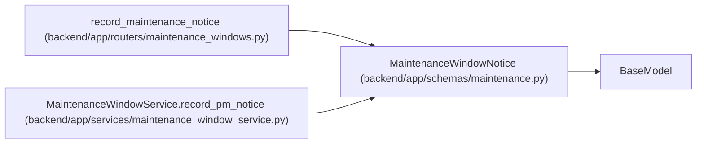

# MaintenanceWindowNotice

**Location:** `backend/app/schemas/maintenance.py:22`
**Kind:** Pydantic model
**Bases:** `BaseModel`
**Module:** [schemas_maintenance](../modules/schemas_maintenance.md)

## Description

An operator's record that a PM was told through another channel.

## Model Configuration

| Setting | Value | Source |
|---------|-------|--------|
| `extra` | `'forbid'` | model_config |

## Attributes

| Name | Type | Wire name | Required | Nullable | Default | Constraints | Examples | Description |
|------|------|-----------|----------|----------|---------|-------------|-------------|----------|
| `actor_id` | `int` | `actor_id` | Yes | No | — | ge=1 | — | — |
| `channel` | `str` | `channel` | Yes | No | — | max_length=60; min_length=1 | — | — |
| `reference` | `str` | `reference` | Yes | No | — | max_length=500; min_length=1 | — | — |

## Methods

*No declared methods.*

## Relationships

<!-- Auto-generated relationship summary. Do not edit by hand. -->

### Summary

| Module | Methods | Attributes |
|---|---:|---|
| [schemas_maintenance](../modules/schemas_maintenance.md) | 0 | `actor_id`, `channel`, `reference` |

### Structure

| Kind | Entity | Module |
|---|---|---|
| Base | `BaseModel` | — |

### References

| Reference | Kind | Source | Call sites |
|---|---|---|---:|
| `record_maintenance_notice` | type_reference | [maintenance_windows](../modules/maintenance_windows.md) | — |
| `MaintenanceWindowService.record_pm_notice` | type_reference | [maintenance_window_service](../modules/maintenance_window_service.md) | — |
