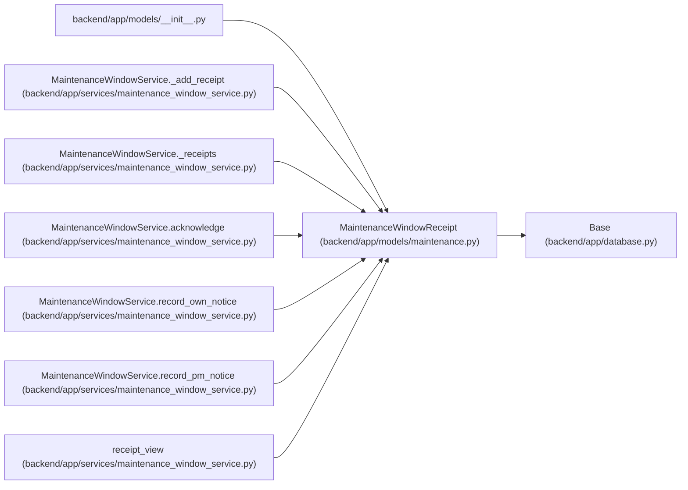

# MaintenanceWindowReceipt

**Location:** `backend/app/models/maintenance.py:64`
**Kind:** Class
**Bases:** `Base`
**Module:** [models_maintenance](../modules/models_maintenance.md)

## Description

A run owner's acknowledgement of a window or a PM's notice of it.

``receipt_key`` names the claim generation (owner) or the PM, so a repeated
acknowledgement returns the original receipt instead of adding another.

## Attributes

| Name | Type | Default | Description |
|------|------|---------|-------------|
| `id` | `Mapped[int]` | `mapped_column(Integer, primary_key=True, autoincrement=True)` | — |
| `window_id` | `Mapped[int]` | `mapped_column(Integer, ForeignKey('maintenance_windows.id', ondelete='CASCADE'), nullable=False, index=True)` | — |
| `kind` | `Mapped[str]` | `mapped_column(String(30), nullable=False)` | — |
| `receipt_key` | `Mapped[str]` | `mapped_column(String(120), nullable=False)` | — |
| `actor_id` | `Mapped[int]` | `mapped_column(Integer, ForeignKey('agent_actors.id', ondelete='CASCADE'), nullable=False, index=True)` | — |
| `source` | `Mapped[str]` | `mapped_column(String(20), nullable=False)` | — |
| `task_id` | `Mapped[Optional[int]]` | `mapped_column(Integer, nullable=True)` | — |
| `run_id` | `Mapped[Optional[int]]` | `mapped_column(Integer, nullable=True)` | — |
| `assignment_id` | `Mapped[Optional[int]]` | `mapped_column(Integer, nullable=True)` | — |
| `claim_generation` | `Mapped[Optional[int]]` | `mapped_column(Integer, nullable=True)` | — |
| `claim_expires_at` | `Mapped[Optional[datetime]]` | `mapped_column(UTCDateTime(), nullable=True)` | — |
| `channel` | `Mapped[Optional[str]]` | `mapped_column(String(60), nullable=True)` | — |
| `reference` | `Mapped[Optional[str]]` | `mapped_column(String(500), nullable=True)` | — |
| `recorded_by_principal_id` | `Mapped[Optional[int]]` | `mapped_column(Integer, ForeignKey('principals.id', ondelete='SET NULL'), nullable=True)` | — |
| `recorded_at` | `Mapped[datetime]` | `mapped_column(UTCDateTime(), nullable=False, default=utc_now)` | — |

## Methods

*No declared methods.*

## Relationships

<!-- Auto-generated relationship summary. Do not edit by hand. -->

### Summary

| Module | Methods | Attributes |
|---|---:|---|
| [models_maintenance](../modules/models_maintenance.md) | 0 | `actor_id`, `assignment_id`, `channel`, `claim_expires_at`, `claim_generation`, `id`, `kind`, `receipt_key`, `recorded_at`, `recorded_by_principal_id`, `reference`, `run_id` |

### Structure

| Kind | Entity | Module |
|---|---|---|
| Base | `Base` | [app_database](../modules/app_database.md) |

### References

| Reference | Kind | Source | Call sites |
|---|---|---|---:|
| `__init__` | import | [models___init__](../modules/models___init__.md) | — |
| `MaintenanceWindowService._add_receipt` | type_reference | [maintenance_window_service](../modules/maintenance_window_service.md) | — |
| `MaintenanceWindowService._receipts` | type_reference | [maintenance_window_service](../modules/maintenance_window_service.md) | — |
| `MaintenanceWindowService.acknowledge` | call | [maintenance_window_service](../modules/maintenance_window_service.md) | 1 |
| `MaintenanceWindowService.record_own_notice` | call | [maintenance_window_service](../modules/maintenance_window_service.md) | 1 |
| `MaintenanceWindowService.record_pm_notice` | call | [maintenance_window_service](../modules/maintenance_window_service.md) | 1 |
| `receipt_view` | type_reference | [maintenance_window_service](../modules/maintenance_window_service.md) | — |
