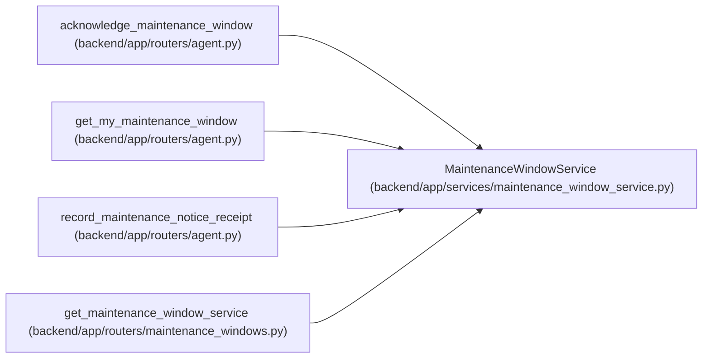

# MaintenanceWindowService

**Location:** `backend/app/services/maintenance_window_service.py:125`
**Kind:** Class
**Bases:** —
**Module:** [maintenance_window_service](../modules/maintenance_window_service.md)

## Description

Operator and agent commands for one coordinated maintenance window.

## Attributes

*No annotated attributes found.*

## Methods

| Method | Signature | Decorators | Description |
|--------|-----------|------------|-------------|
| `__init__` | `(db: AsyncSession)` | — | — |
| `_window` | *(async)* `(window_id: int, *, lock: bool = False) -> MaintenanceWindow` | — | — |
| `_live_claims` | *(async)* `(now: datetime, *, actor_id: int \| None = None) -> list[dict[str, Any]]` | — | — |
| `_running_runs` | *(async)* `(task_ids: list[int] \| None = None) -> list[Any]` | — | — |
| `_pm_recipients` | *(async)* `() -> list[AgentActor]` | — | — |
| `_receipts` | *(async)* `(window_id: int) -> dict[str, MaintenanceWindowReceipt]` | — | — |
| `evaluate` | *(async)* `(window: MaintenanceWindow, now: datetime \| None = None) -> dict[str, Any]` | — | Return what still stands between this window and a safe begin. |
| `list_windows` | *(async)* `(*, limit: int = 20) -> list[dict[str, Any]]` | — | — |
| `status` | *(async)* `(window_id: int) -> dict[str, Any]` | — | — |
| `announce` | *(async)* `(data: MaintenanceWindowCreate) -> dict[str, Any]` | — | — |
| `record_pm_notice` | *(async)* `(window_id: int, data: MaintenanceWindowNotice) -> dict[str, Any]` | — | Record that a PM was told through another channel. This is never run-owner consent. |
| `begin` | *(async)* `(window_id: int) -> dict[str, Any]` | — | — |
| `close` | *(async)* `(window_id: int, data: MaintenanceWindowClose) -> dict[str, Any]` | — | — |
| `cancel` | *(async)* `(window_id: int, note: str \| None) -> dict[str, Any]` | — | — |
| `_resumption` | *(async)* `(entry: dict[str, Any], now: datetime) -> dict[str, Any]` | — | — |
| `current_for_actor` | *(async)* `(actor: AgentActor) -> dict[str, Any]` | — | — |
| `acknowledge` | *(async)* `(actor: AgentActor, window_id: int, data: MaintenanceOwnerAcknowledgement) -> dict[str, Any]` | — | Record the live claim owner's own acknowledgement of the bounded window. |
| `record_own_notice` | *(async)* `(actor: AgentActor, window_id: int) -> dict[str, Any]` | — | — |
| `_require_state` | `(window: MaintenanceWindow, state: str) -> None` | `@staticmethod` | — |
| `_add_receipt` | *(async)* `(receipt: MaintenanceWindowReceipt) -> MaintenanceWindowReceipt` | — | — |

## Relationships

<!-- Auto-generated relationship summary. Do not edit by hand. -->

### Summary

| Module | Methods | Attributes |
|---|---:|---|
| [maintenance_window_service](../modules/maintenance_window_service.md) | 20 | — |

### References

| Reference | Kind | Source | Call sites |
|---|---|---|---:|
| `acknowledge_maintenance_window` | call | [routers_agent](../modules/routers_agent.md) | 1 |
| `get_my_maintenance_window` | call | [routers_agent](../modules/routers_agent.md) | 1 |
| `record_maintenance_notice_receipt` | call | [routers_agent](../modules/routers_agent.md) | 1 |
| `get_maintenance_window_service` | call | [maintenance_windows](../modules/maintenance_windows.md) | 1 |
| `get_maintenance_window_service` | type_reference | [maintenance_windows](../modules/maintenance_windows.md) | — |
