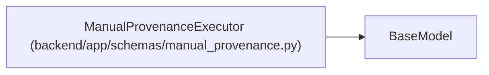

# ManualProvenanceExecutor

**Location:** `backend/app/schemas/manual_provenance.py:9`
**Kind:** Pydantic model
**Bases:** `BaseModel`
**Module:** [manual_provenance](../modules/manual_provenance.md)

## Description

The human or agent that actually executed the work.

## Model Configuration

| Setting | Value | Source |
|---------|-------|--------|
| `extra` | `'forbid'` | model_config |

## Validators

| Method | Scope | Fields | Mode | Options |
|--------|-------|--------|------|---------|
| `_one_identity` | model | — | after | — |

## Attributes

| Name | Type | Wire name | Required | Nullable | Default | Constraints | Examples | Description |
|------|------|-----------|----------|----------|---------|-------------|-------------|----------|
| `kind` | `Literal['human', 'agent']` | `kind` | Yes | No | — | — | — | — |
| `principal_id` | `int \| None` | `principal_id` | No | Yes | `None` | ge=1 | — | The human who executed the work; required for kind human. |
| `actor_id` | `int \| None` | `actor_id` | No | Yes | `None` | ge=1 | — | The agent actor that executed the work; required for kind agent. |
| `model_binding_id` | `int \| None` | `model_binding_id` | No | Yes | `None` | ge=1 | — | The agent's model binding used for the work; its default binding when omitted. Only for kind agent. |

## Methods

| Method | Signature | Decorators | Description |
|--------|-----------|------------|-------------|
| `_one_identity` | `()` | `@model_validator(mode='after')` | — |

## Relationships

<!-- Auto-generated relationship summary. Do not edit by hand. -->

### Summary

| Module | Methods | Attributes |
|---|---:|---|
| [manual_provenance](../modules/manual_provenance.md) | 1 | `actor_id`, `kind`, `model_binding_id`, `principal_id` |

### Structure

| Kind | Entity | Module |
|---|---|---|
| Base | `BaseModel` | — |
