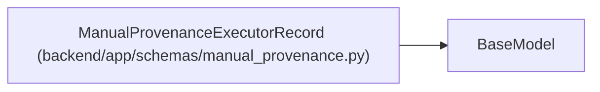

# ManualProvenanceExecutorRecord

**Location:** `backend/app/schemas/manual_provenance.py:80`
**Kind:** Pydantic model
**Bases:** `BaseModel`
**Module:** [manual_provenance](../modules/manual_provenance.md)

## Description

_Auto-generated from `ManualProvenanceExecutorRecord` in `backend/app/schemas/manual_provenance.py`._

## Attributes

| Name | Type | Wire name | Required | Nullable | Default | Constraints | Examples | Description |
|------|------|-----------|----------|----------|---------|-------------|-------------|----------|
| `kind` | `Literal['human', 'agent']` | `kind` | Yes | No | — | — | — | — |
| `principal_id` | `int \| None` | `principal_id` | No | Yes | `None` | — | — | — |
| `actor_id` | `int \| None` | `actor_id` | No | Yes | `None` | — | — | — |
| `profile_ids` | `list[int]` | `profile_ids` | No | No | factory: `list` | — | — | Profiles that count as the executor's for review independence. |
| `binding_id` | `int \| None` | `binding_id` | No | Yes | `None` | — | — | — |
| `catalog_key` | `str \| None` | `catalog_key` | No | Yes | `None` | — | — | — |
| `publisher_key` | `str \| None` | `publisher_key` | No | Yes | `None` | — | — | The agent executor's model publisher at the time of the record. |

## Methods

*No declared methods.*

## Relationships

<!-- Auto-generated relationship summary. Do not edit by hand. -->

### Summary

| Module | Methods | Attributes |
|---|---:|---|
| [manual_provenance](../modules/manual_provenance.md) | 0 | `actor_id`, `binding_id`, `catalog_key`, `kind`, `principal_id`, `profile_ids`, `publisher_key` |

### Structure

| Kind | Entity | Module |
|---|---|---|
| Base | `BaseModel` | — |
