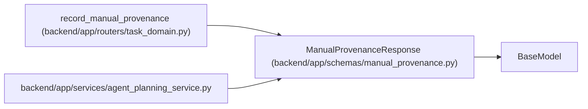

# ManualProvenanceResponse

**Location:** `backend/app/schemas/manual_provenance.py:90`
**Kind:** Pydantic model
**Bases:** `BaseModel`
**Module:** [manual_provenance](../modules/manual_provenance.md)

## Description

The recorded provenance as it appears on the task timeline.

## Attributes

| Name | Type | Wire name | Required | Nullable | Default | Constraints | Examples | Description |
|------|------|-----------|----------|----------|---------|-------------|-------------|----------|
| `event_id` | `int` | `event_id` | Yes | No | — | — | — | — |
| `task_id` | `int` | `task_id` | Yes | No | — | — | — | — |
| `task_version` | `int` | `task_version` | Yes | No | — | — | — | — |
| `brief_revision` | `int` | `brief_revision` | Yes | No | — | — | — | — |
| `artifact_revision` | `int` | `artifact_revision` | Yes | No | — | — | — | — |
| `executor` | `ManualProvenanceExecutorRecord` | `executor` | Yes | No | — | — | — | — |
| `head_commit_url` | `str` | `head_commit_url` | Yes | No | — | — | — | — |
| `commit_urls` | `list[str]` | `commit_urls` | Yes | No | — | — | — | — |
| `pr_url` | `str \| None` | `pr_url` | No | Yes | `None` | — | — | — |
| `base_commit_url` | `str \| None` | `base_commit_url` | No | Yes | `None` | — | — | — |
| `reason` | `str` | `reason` | Yes | No | — | — | — | — |
| `recorded_by_principal_id` | `int \| None` | `recorded_by_principal_id` | No | Yes | `None` | — | — | — |
| `recorded_by_actor_id` | `int \| None` | `recorded_by_actor_id` | No | Yes | `None` | — | — | — |
| `recorder_publisher_key` | `str \| None` | `recorder_publisher_key` | No | Yes | `None` | — | — | An agent recorder's model publisher. An agent recorder counts as a contributor, so a verifier must differ from it too. |
| `recorded_at` | `datetime \| None` | `recorded_at` | No | Yes | `None` | — | — | — |

## Methods

*No declared methods.*

## Relationships

<!-- Auto-generated relationship summary. Do not edit by hand. -->

### Summary

| Module | Methods | Attributes |
|---|---:|---|
| [manual_provenance](../modules/manual_provenance.md) | 0 | `artifact_revision`, `base_commit_url`, `brief_revision`, `commit_urls`, `event_id`, `executor`, `head_commit_url`, `pr_url`, `reason`, `recorded_at`, `recorded_by_actor_id`, `recorded_by_principal_id` |

### Structure

| Kind | Entity | Module |
|---|---|---|
| Base | `BaseModel` | — |

### References

| Reference | Kind | Source | Call sites |
|---|---|---|---:|
| `record_manual_provenance` | type_reference | [routers_task_domain](../modules/routers_task_domain.md) | — |
| `agent_planning_service` | import | [agent_planning_service](../modules/agent_planning_service.md) | — |
