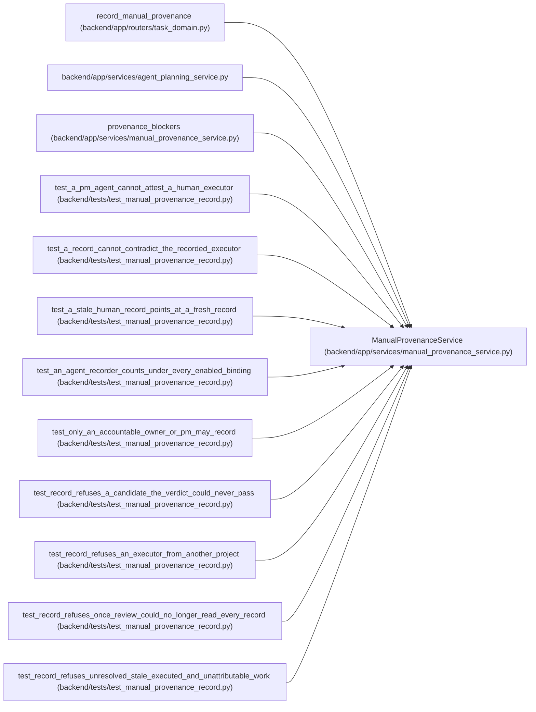

# ManualProvenanceService

**Location:** `backend/app/services/manual_provenance_service.py:200`
**Kind:** Class
**Bases:** —
**Module:** [manual_provenance_service](../modules/manual_provenance_service.md)

## Description

Records who executed resolved work that was delivered outside recorded runs, together with the exact commits, pull request or base commit of the delivered candidate. A record is an append-only task event written by an accountable owner, operator, project manager or the project's PM agent; the candidate is checked against GitHub before any lock is taken. Recording never reopens, resolves or accepts the task. Review reads these records so a manually delivered task still has attributable contributors and a candidate to verify, and a verifier must differ from each recorded executor and agent recorder.

## Attributes

*No annotated attributes found.*

## Methods

| Method | Signature | Decorators | Description |
|--------|-----------|------------|-------------|
| `__init__` | `(db)` | — | — |
| `tasks` | `()` | `@property` | — |
| `record` | *(async)* `(task_id, data, *, commit = True)` | — | Record the executor and the delivered candidate of one resolved task. |
| `_verify_candidate` | *(async)* `(task, links)` | — | Refuse a candidate that the verdict-time check could never pass. |
| `_record` | *(async)* `(task_id, data, links, *, commit = True)` | `@atomic_command` | — |
| `_require_no_recorded_execution` | *(async)* `(task)` | — | — |
| `_require_consistent_executor` | `(task, executor)` | `@staticmethod` | A record never contradicts authenticated manual execution of the task. |
| `_require_task_evidence` | *(async)* `(task, pr_url)` | — | The declared pull request must already be the task's own evidence. |
| `_agent_recorder` | *(async)* `(actor_id)` | — | An agent recorder is accountable like a contributor: its actor, profile and publisher are kept. |
| `_require_project_actor` | *(async)* `(actor, task)` | — | The agent executor must belong to the task's project. |
| `_executor` | *(async)* `(data, task)` | — | — |
| `_binding_receipt` | *(async)* `(actor, binding_id)` | — | The executor's profile, binding and publisher at the moment of the record. |

## Relationships

<!-- Auto-generated relationship summary. Do not edit by hand. -->

### Summary

| Module | Methods | Attributes |
|---|---:|---|
| [manual_provenance_service](../modules/manual_provenance_service.md) | 12 | — |

### References

| Reference | Kind | Source | Call sites |
|---|---|---|---:|
| `record_manual_provenance` | call | [routers_task_domain](../modules/routers_task_domain.md) | 1 |
| `agent_planning_service` | import | [agent_planning_service](../modules/agent_planning_service.md) | — |
| `provenance_blockers` | call | [manual_provenance_service](../modules/manual_provenance_service.md) | 1 |
| `test_a_pm_agent_cannot_attest_a_human_executor` | call | [test_manual_provenance_record](../modules/test_manual_provenance_record.md) | 1 |
| `test_a_record_cannot_contradict_the_recorded_executor` | call | [test_manual_provenance_record](../modules/test_manual_provenance_record.md) | 4 |
| `test_a_stale_human_record_points_at_a_fresh_record` | call | [test_manual_provenance_record](../modules/test_manual_provenance_record.md) | 1 |
| `test_an_agent_recorder_counts_under_every_enabled_binding` | call | [test_manual_provenance_record](../modules/test_manual_provenance_record.md) | 1 |
| `test_only_an_accountable_owner_or_pm_may_record` | call | [test_manual_provenance_record](../modules/test_manual_provenance_record.md) | 1 |
| `test_record_refuses_a_candidate_the_verdict_could_never_pass` | call | [test_manual_provenance_record](../modules/test_manual_provenance_record.md) | 1 |
| `test_record_refuses_an_executor_from_another_project` | call | [test_manual_provenance_record](../modules/test_manual_provenance_record.md) | 2 |
| `test_record_refuses_once_review_could_no_longer_read_every_record` | call | [test_manual_provenance_record](../modules/test_manual_provenance_record.md) | 1 |
| `test_record_refuses_unresolved_stale_executed_and_unattributable_work` | call | [test_manual_provenance_record](../modules/test_manual_provenance_record.md) | 3 |

> References: showing 12 of 14 logical references; 2 omitted by the 12-row generated summary limit.
