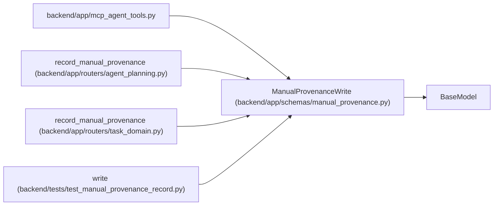

# ManualProvenanceWrite

**Location:** `backend/app/schemas/manual_provenance.py:29`
**Kind:** Pydantic model
**Bases:** `BaseModel`
**Module:** [manual_provenance](../modules/manual_provenance.md)

## Description

Record who executed one resolved task and the exact repository candidate they delivered.

## Model Configuration

| Setting | Value | Source |
|---------|-------|--------|
| `extra` | `'forbid'` | model_config |

## Validators

| Method | Scope | Fields | Mode | Options |
|--------|-------|--------|------|---------|
| `_stripped` | field | reason, head_commit_url | after | — |
| `_optional_stripped` | field | pr_url, base_commit_url | after | — |
| `_commits` | field | commit_urls | after | — |
| `_candidate_shape` | model | — | after | — |

## Attributes

| Name | Type | Wire name | Required | Nullable | Default | Constraints | Examples | Description |
|------|------|-----------|----------|----------|---------|-------------|-------------|----------|
| `expected_version` | `int` | `expected_version` | Yes | No | — | ge=1 | — | — |
| `artifact_revision` | `int` | `artifact_revision` | Yes | No | — | ge=0 | — | The task's current artifact revision; the record applies to it only. |
| `executor` | `ManualProvenanceExecutor` | `executor` | Yes | No | — | — | — | — |
| `head_commit_url` | `str` | `head_commit_url` | Yes | No | — | max_length=1000; min_length=1 | — | Immutable GitHub commit URL of the delivered head. |
| `commit_urls` | `list[str]` | `commit_urls` | No | No | factory: `list` | max_length=250 | — | Every GitHub commit the executor contributed to the candidate. The head commit is always included. |
| `pr_url` | `str \| None` | `pr_url` | No | Yes | `None` | max_length=1000 | — | The GitHub pull request that carries the head commit. |
| `base_commit_url` | `str \| None` | `base_commit_url` | No | Yes | `None` | max_length=1000 | — | Immutable GitHub commit the work started from, for a commit range without a pull request. |
| `reason` | `str` | `reason` | Yes | No | — | max_length=2000; min_length=1 | — | Why the work was executed outside recorded runs and how the record was established. |

## Methods

| Method | Signature | Decorators | Description |
|--------|-----------|------------|-------------|
| `_stripped` | `(value: str) -> str` | `@field_validator('reason', 'head_commit_url')`, `@classmethod` | — |
| `_optional_stripped` | `(value: str \| None) -> str \| None` | `@field_validator('pr_url', 'base_commit_url')`, `@classmethod` | — |
| `_commits` | `(value: list[str]) -> list[str]` | `@field_validator('commit_urls')`, `@classmethod` | — |
| `_candidate_shape` | `()` | `@model_validator(mode='after')` | — |

## Relationships

<!-- Auto-generated relationship summary. Do not edit by hand. -->

### Summary

| Module | Methods | Attributes |
|---|---:|---|
| [manual_provenance](../modules/manual_provenance.md) | 4 | `artifact_revision`, `base_commit_url`, `commit_urls`, `executor`, `expected_version`, `head_commit_url`, `pr_url`, `reason` |

### Structure

| Kind | Entity | Module |
|---|---|---|
| Base | `BaseModel` | — |

### References

| Reference | Kind | Source | Call sites |
|---|---|---|---:|
| `mcp_agent_tools` | import | [mcp_agent_tools](../modules/mcp_agent_tools.md) | — |
| `record_manual_provenance` | type_reference | [routers_agent_planning](../modules/routers_agent_planning.md) | — |
| `record_manual_provenance` | type_reference | [routers_task_domain](../modules/routers_task_domain.md) | — |
| `write` | call | [test_manual_provenance_record](../modules/test_manual_provenance_record.md) | 1 |
