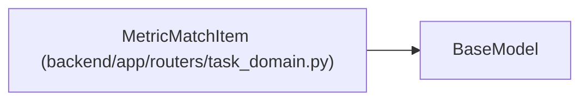

# MetricMatchItem

**Location:** `backend/app/routers/task_domain.py:93`
**Kind:** Pydantic model
**Bases:** `BaseModel`
**Module:** [routers_task_domain](../modules/routers_task_domain.md)

## Description

_Auto-generated from `MetricMatchItem` in `backend/app/routers/task_domain.py`._

## Attributes

| Name | Type | Wire name | Required | Nullable | Default | Constraints | Examples | Description |
|------|------|-----------|----------|----------|---------|-------------|-------------|----------|
| `id` | `int` | `id` | Yes | No | — | — | — | — |
| `title` | `str` | `title` | Yes | No | — | — | — | — |
| `status` | `str` | `status` | Yes | No | — | — | — | — |
| `project_name` | `str \| None` | `project_name` | Yes | Yes | — | — | — | — |
| `iteration_name` | `str \| None` | `iteration_name` | Yes | Yes | — | — | — | — |

## Methods

*No declared methods.*

## Relationships

<!-- Auto-generated relationship summary. Do not edit by hand. -->

### Summary

| Module | Methods | Attributes |
|---|---:|---|
| [routers_task_domain](../modules/routers_task_domain.md) | 0 | `id`, `iteration_name`, `project_name`, `status`, `title` |

### Structure

| Kind | Entity | Module |
|---|---|---|
| Base | `BaseModel` | — |
