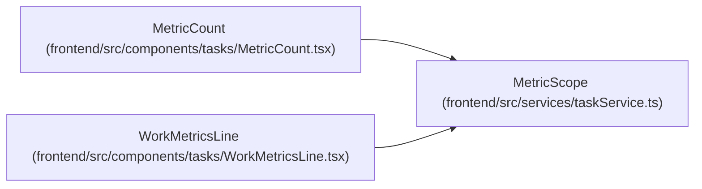

# MetricScope

**Location:** `frontend/src/services/taskService.ts:276`
**Kind:** Type alias
**Bases:** —
**Module:** [taskService](../modules/taskService.md)
**Target:**

```typescript
{ project_id: number } | { iteration_id: number } | { release_id: number }
```

## Description

_Auto-generated from `MetricScope` in `frontend/src/services/taskService.ts`._

## Attributes

*See the alias definition for its member types.*

## Methods

*See the alias definition for callable and member types.*

## Relationships

<!-- Auto-generated relationship summary. Do not edit by hand. -->


### Summary

| Module | Methods | Attributes |
|---|---:|---|
| [taskService](../modules/taskService.md) | 0 | — |

### References

| Reference | Kind | Source | Call sites |
|---|---|---|---:|
| `MetricCount` | type_reference | [MetricCount](../modules/MetricCount.md) | — |
| `WorkMetricsLine` | type_reference | [WorkMetricsLine](../modules/WorkMetricsLine.md) | — |
