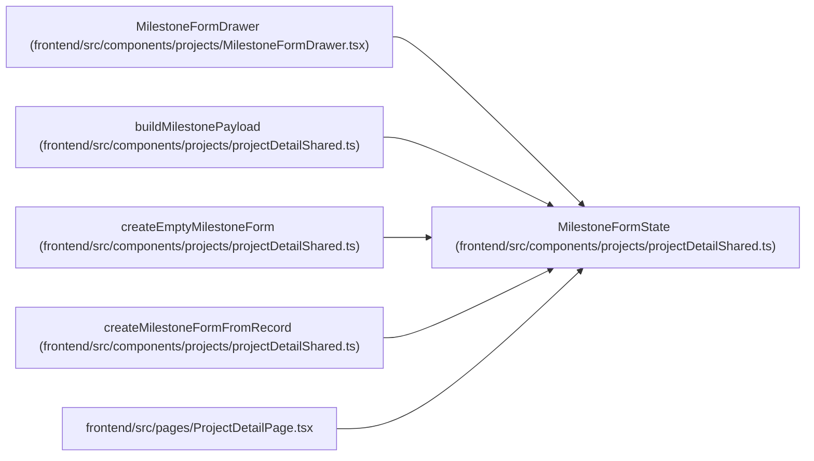

# MilestoneFormState

**Location:** `frontend/src/components/projects/projectDetailShared.ts:111`
**Kind:** Type alias
**Bases:** —
**Module:** [projectDetailShared](../modules/projectDetailShared.md)
**Target:**

```typescript
{
    name: string;
    description: string;
    target_date: string;
    completed_at: string;
    sort_order: string;
    status: ProjectMilestoneStatus;
}
```

## Description

_Auto-generated from `MilestoneFormState` in `frontend/src/components/projects/projectDetailShared.ts`._

## Attributes

*See the alias definition for its member types.*

## Methods

*See the alias definition for callable and member types.*

## Relationships

<!-- Auto-generated relationship summary. Do not edit by hand. -->


### Summary

| Module | Methods | Attributes |
|---|---:|---|
| [projectDetailShared](../modules/projectDetailShared.md) | 0 | — |

### References

| Reference | Kind | Source | Call sites |
|---|---|---|---:|
| `MilestoneFormDrawer` | type_reference | [MilestoneFormDrawer](../modules/MilestoneFormDrawer.md) | — |
| `buildMilestonePayload` | type_reference | [projectDetailShared](../modules/projectDetailShared.md) | — |
| `createEmptyMilestoneForm` | type_reference | [projectDetailShared](../modules/projectDetailShared.md) | — |
| `createMilestoneFormFromRecord` | type_reference | [projectDetailShared](../modules/projectDetailShared.md) | — |
| `ProjectDetailPage` | import | [ProjectDetailPage](../modules/ProjectDetailPage.md) | — |
