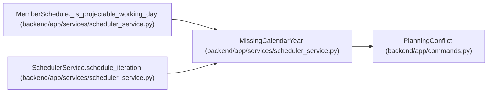

# MissingCalendarYear

**Location:** `backend/app/services/scheduler_service.py:28`
**Kind:** Class
**Bases:** `PlanningConflict`
**Module:** [scheduler_service](../modules/scheduler_service.md)

## Description

_Auto-generated from `MissingCalendarYear` in `backend/app/services/scheduler_service.py`._

The scheduler uses this conflict when a forecast reaches a local date without a selected annual policy. A preview reports the missing year and restores draft task dates. An attempted commitment remains blocked.

## Attributes

*No annotated attributes found.*

## Methods

| Method | Signature | Decorators | Description |
|--------|-----------|------------|-------------|
| `__init__` | `(year: int)` | — | — |

## Relationships

<!-- Auto-generated relationship summary. Do not edit by hand. -->

### Summary

| Module | Methods | Attributes |
|---|---:|---|
| [scheduler_service](../modules/scheduler_service.md) | 1 | — |

### Structure

| Kind | Entity | Module |
|---|---|---|
| Base | `PlanningConflict` | [commands](../modules/commands.md) |

### References

| Reference | Kind | Source | Call sites |
|---|---|---|---:|
| `MemberSchedule._is_projectable_working_day` | call | [scheduler_service](../modules/scheduler_service.md) | 1 |
| `SchedulerService.schedule_iteration` | call | [scheduler_service](../modules/scheduler_service.md) | 1 |
