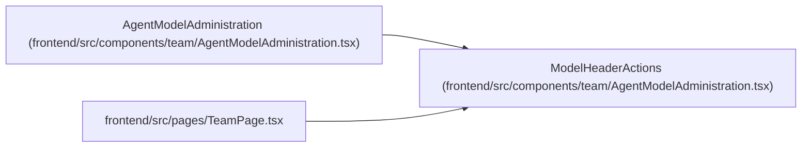

# ModelHeaderActions

**Location:** `frontend/src/components/team/AgentModelAdministration.tsx:128`
**Kind:** Interface
**Bases:** —
**Module:** [AgentModelAdministration](../modules/AgentModelAdministration.md)

## Description

_Auto-generated from `ModelHeaderActions` in `frontend/src/components/team/AgentModelAdministration.tsx`._

## Attributes

| Name | Type | Required | Default | Description |
|------|------|----------|---------|-------------|
| `primaryAction` | `ReactNode` | Yes | — | — |
| `overflowItems` | `OverflowMenuItem[]` | Yes | — | — |

## Methods

*No declared methods.*

## Relationships

<!-- Auto-generated relationship summary. Do not edit by hand. -->

### Summary

| Module | Methods | Attributes |
|---|---:|---|
| [AgentModelAdministration](../modules/AgentModelAdministration.md) | 0 | `overflowItems`, `primaryAction` |

### References

| Reference | Kind | Source | Call sites |
|---|---|---|---:|
| `AgentModelAdministration` | type_reference | [AgentModelAdministration](../modules/AgentModelAdministration.md) | — |
| `TeamPage` | import | [TeamPage](../modules/TeamPage.md) | — |
