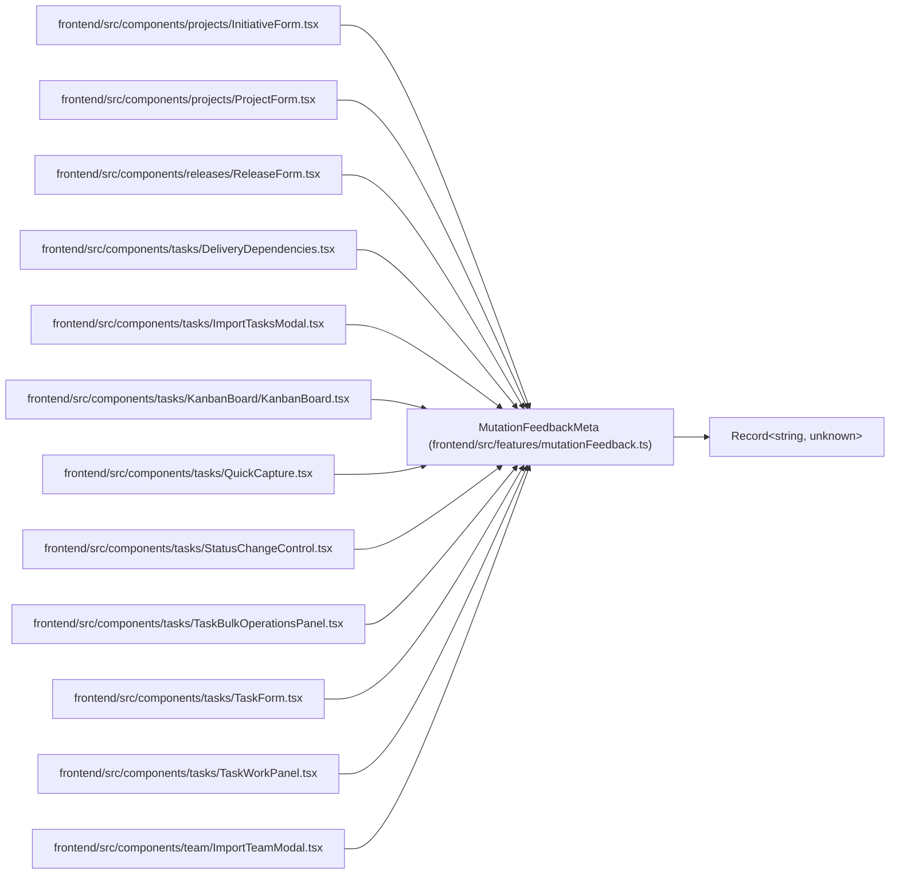

# MutationFeedbackMeta

**Location:** `frontend/src/features/mutationFeedback.ts:15`
**Kind:** Interface
**Bases:** `Record<string, unknown>`
**Module:** [mutationFeedback](../modules/mutationFeedback.md)

## Description

Put on a mutation's `meta` to announce its result. One listener shows the
success toast, so every write ends with the same visible, announced message;
errors stay where they happened (inline) and in the error toast.

## Attributes

| Name | Type | Required | Default | Description |
|------|------|----------|---------|-------------|
| `success` | `string \| ((data: unknown, variables: unknown) => string \| null \| undefined)` | No | — | — |
| `undo` | `(data: unknown, variables: unknown) => MutationUndo \| null \| undefined` | No | — | — |

## Methods

*No declared methods.*

## Relationships

<!-- Auto-generated relationship summary. Do not edit by hand. -->

### Summary

| Module | Methods | Attributes |
|---|---:|---|
| [mutationFeedback](../modules/mutationFeedback.md) | 0 | `success`, `undo` |

### Structure

| Kind | Entity | Module |
|---|---|---|
| Base | `Record<string, unknown>` | — |

### References

| Reference | Kind | Source | Call sites |
|---|---|---|---:|
| `InitiativeForm` | import | [InitiativeForm](../modules/InitiativeForm.md) | — |
| `ProjectForm` | import | [ProjectForm](../modules/ProjectForm.md) | — |
| `ReleaseForm` | import | [ReleaseForm](../modules/ReleaseForm.md) | — |
| `DeliveryDependencies` | import | [DeliveryDependencies](../modules/DeliveryDependencies.md) | — |
| `ImportTasksModal` | import | [ImportTasksModal](../modules/ImportTasksModal.md) | — |
| `KanbanBoard` | import | [KanbanBoard](../modules/KanbanBoard.md) | — |
| `QuickCapture` | import | [QuickCapture](../modules/QuickCapture.md) | — |
| `StatusChangeControl` | import | [StatusChangeControl](../modules/StatusChangeControl.md) | — |
| `TaskBulkOperationsPanel` | import | [TaskBulkOperationsPanel](../modules/TaskBulkOperationsPanel.md) | — |
| `TaskForm` | import | [TaskForm](../modules/TaskForm.md) | — |
| `TaskWorkPanel` | import | [TaskWorkPanel](../modules/TaskWorkPanel.md) | — |
| `ImportTeamModal` | import | [ImportTeamModal](../modules/ImportTeamModal.md) | — |

> References: showing 12 of 22 logical references; 10 omitted by the 12-row generated summary limit.
