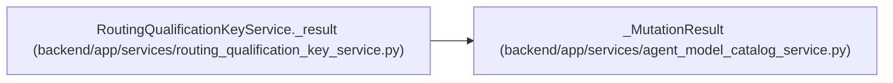

# _MutationResult

**Location:** `backend/app/services/agent_model_catalog_service.py:76`
**Kind:** Class
**Bases:** —
**Module:** [agent_model_catalog_service](../modules/agent_model_catalog_service.md)

**Decorators:** `@dataclass(frozen=True)`

## Description

_Auto-generated from `_MutationResult` in `backend/app/services/agent_model_catalog_service.py`._

## Attributes

| Name | Type | Default | Description |
|------|------|---------|-------------|
| `target_type` | `Literal['model_catalog', 'model_binding', 'routing_qualification_key']` | *required* | — |
| `target_id` | `int` | *required* | — |
| `authoritative_revision` | `int` | *required* | — |
| `result` | `dict[str, Any]` | *required* | — |
| `invalidated_assignment_ids` | `tuple[int, ...]` | `()` | — |
| `audit_event_ids` | `tuple[int, ...]` | `()` | — |

## Methods

*No declared methods.*

## Relationships

<!-- Auto-generated relationship summary. Do not edit by hand. -->

### Summary

| Module | Methods | Attributes |
|---|---:|---|
| [agent_model_catalog_service](../modules/agent_model_catalog_service.md) | 0 | `audit_event_ids`, `authoritative_revision`, `invalidated_assignment_ids`, `result`, `target_id`, `target_type` |

### References

| Reference | Kind | Source | Call sites |
|---|---|---|---:|
| `RoutingQualificationKeyService._result` | call | [routing_qualification_key_service](../modules/routing_qualification_key_service.md) | 1 |
| `RoutingQualificationKeyService._result` | type_reference | [routing_qualification_key_service](../modules/routing_qualification_key_service.md) | — |
