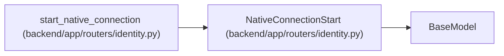

# NativeConnectionStart

**Location:** `backend/app/routers/identity.py:32`
**Kind:** Pydantic model
**Bases:** `BaseModel`
**Module:** [routers_identity](../modules/routers_identity.md)

## Description

_Auto-generated from `NativeConnectionStart` in `backend/app/routers/identity.py`._

## Model Configuration

| Setting | Value | Source |
|---------|-------|--------|
| `extra` | `'forbid'` | model_config |

## Validators

| Method | Scope | Fields | Mode | Options |
|--------|-------|--------|------|---------|
| `plain_label` | field | client_label | after | — |

## Attributes

| Name | Type | Wire name | Required | Nullable | Default | Constraints | Examples | Description |
|------|------|-----------|----------|----------|---------|-------------|-------------|----------|
| `code_challenge` | `str` | `code_challenge` | Yes | No | — | pattern='^[A-Za-z0-9_-]{43}$' | — | — |
| `access` | `Literal['full', 'observe']` | `access` | No | No | `'full'` | — | — | — |
| `client_label` | `str \| None` | `client_label` | No | Yes | `None` | max_length=80; min_length=1 | — | — |

## Methods

| Method | Signature | Decorators | Description |
|--------|-----------|------------|-------------|
| `plain_label` | `(value)` | `@field_validator('client_label')`, `@classmethod` | — |

## Relationships

<!-- Auto-generated relationship summary. Do not edit by hand. -->

### Summary

| Module | Methods | Attributes |
|---|---:|---|
| [routers_identity](../modules/routers_identity.md) | 1 | `access`, `client_label`, `code_challenge` |

### Structure

| Kind | Entity | Module |
|---|---|---|
| Base | `BaseModel` | — |

### References

| Reference | Kind | Source | Call sites |
|---|---|---|---:|
| `start_native_connection` | type_reference | [routers_identity](../modules/routers_identity.md) | — |
