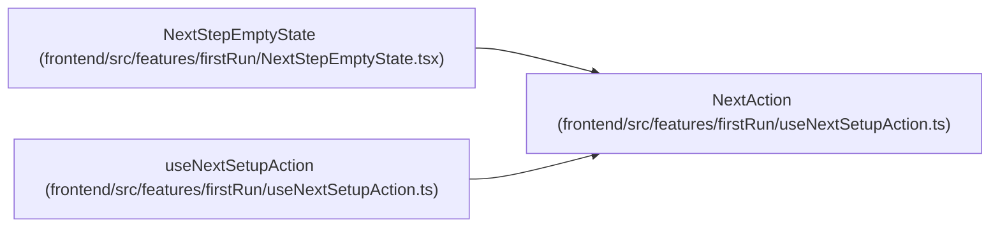

# NextAction

**Location:** `frontend/src/features/firstRun/useNextSetupAction.ts:6`
**Kind:** Type alias
**Bases:** —
**Module:** [useNextSetupAction](../modules/useNextSetupAction.md)
**Target:**

```typescript
{ label: string; to: string } | { label: string; onClick: () => void }
```

## Description

_Auto-generated from `NextAction` in `frontend/src/features/firstRun/useNextSetupAction.ts`._

## Attributes

*See the alias definition for its member types.*

## Methods

*See the alias definition for callable and member types.*

## Relationships

<!-- Auto-generated relationship summary. Do not edit by hand. -->


### Summary

| Module | Methods | Attributes |
|---|---:|---|
| [useNextSetupAction](../modules/useNextSetupAction.md) | 0 | — |

### References

| Reference | Kind | Source | Call sites |
|---|---|---|---:|
| `NextStepEmptyState` | type_reference | [NextStepEmptyState](../modules/NextStepEmptyState.md) | — |
| `useNextSetupAction` | type_reference | [useNextSetupAction](../modules/useNextSetupAction.md) | — |
