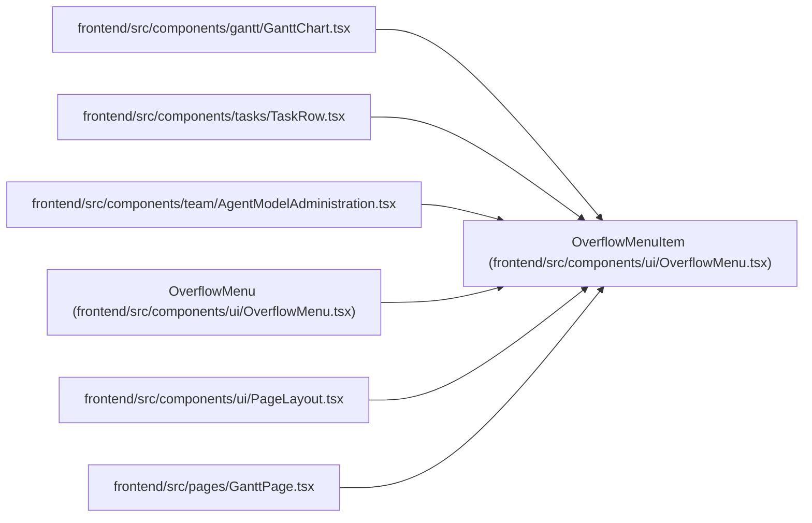

# OverflowMenuItem

**Location:** `frontend/src/components/ui/OverflowMenu.tsx:9`
**Kind:** Type alias
**Bases:** —
**Module:** [OverflowMenu](../modules/OverflowMenu.md)
**Target:**

```typescript
{
    label: ReactNode;
    icon?: ReactNode;
    onSelect: () => void;
    tone?: 'default' | 'danger';
    disabled?: boolean;
}
```

## Description

_Auto-generated from `OverflowMenuItem` in `frontend/src/components/ui/OverflowMenu.tsx`._

## Attributes

*See the alias definition for its member types.*

## Methods

*See the alias definition for callable and member types.*

## Relationships

<!-- Auto-generated relationship summary. Do not edit by hand. -->


### Summary

| Module | Methods | Attributes |
|---|---:|---|
| [OverflowMenu](../modules/OverflowMenu.md) | 0 | — |

### References

| Reference | Kind | Source | Call sites |
|---|---|---|---:|
| `GanttChart` | import | [GanttChart](../modules/GanttChart.md) | — |
| `TaskRow` | import | [TaskRow](../modules/TaskRow.md) | — |
| `AgentModelAdministration` | import | [AgentModelAdministration](../modules/AgentModelAdministration.md) | — |
| `OverflowMenu` | type_reference | [OverflowMenu](../modules/OverflowMenu.md) | — |
| `PageLayout` | import | [PageLayout](../modules/PageLayout.md) | — |
| `GanttPage` | import | [GanttPage](../modules/GanttPage.md) | — |
