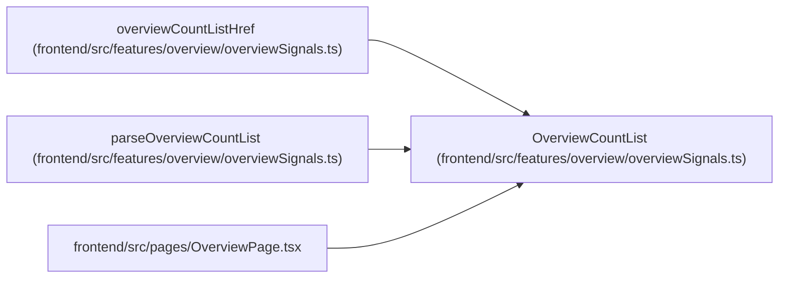

# OverviewCountList

**Location:** `frontend/src/features/overview/overviewSignals.ts:77`
**Kind:** Type alias
**Bases:** —
**Module:** [overviewSignals](../modules/overviewSignals.md)
**Target:**

```typescript
OverviewTaskList
```

## Description

A list Overview can show itself, for task counts that no single Tasks list holds: a sum
over several iterations, or Backlog work, which the Tasks backlog does not filter.

## Attributes

*See the alias definition for its member types.*

## Methods

*See the alias definition for callable and member types.*

## Relationships

<!-- Auto-generated relationship summary. Do not edit by hand. -->


### Summary

| Module | Methods | Attributes |
|---|---:|---|
| [overviewSignals](../modules/overviewSignals.md) | 0 | — |

### References

| Reference | Kind | Source | Call sites |
|---|---|---|---:|
| `overviewCountListHref` | type_reference | [overviewSignals](../modules/overviewSignals.md) | — |
| `parseOverviewCountList` | type_reference | [overviewSignals](../modules/overviewSignals.md) | — |
| `OverviewPage` | import | [OverviewPage](../modules/OverviewPage.md) | — |
