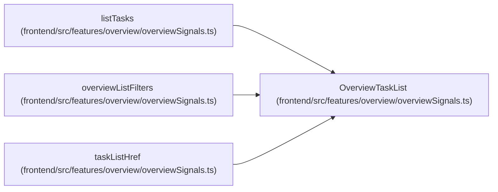

# OverviewTaskList

**Location:** `frontend/src/features/overview/overviewSignals.ts:23`
**Kind:** Type alias
**Bases:** —
**Module:** [overviewSignals](../modules/overviewSignals.md)
**Target:**

```typescript
keyof typeof OVERVIEW_TASK_LISTS
```

## Description

_Auto-generated from `OverviewTaskList` in `frontend/src/features/overview/overviewSignals.ts`._

## Attributes

*See the alias definition for its member types.*

## Methods

*See the alias definition for callable and member types.*

## Relationships

<!-- Auto-generated relationship summary. Do not edit by hand. -->


### Summary

| Module | Methods | Attributes |
|---|---:|---|
| [overviewSignals](../modules/overviewSignals.md) | 0 | — |

### References

| Reference | Kind | Source | Call sites |
|---|---|---|---:|
| `listTasks` | type_reference | [overviewSignals](../modules/overviewSignals.md) | — |
| `overviewListFilters` | type_reference | [overviewSignals](../modules/overviewSignals.md) | — |
| `taskListHref` | type_reference | [overviewSignals](../modules/overviewSignals.md) | — |
